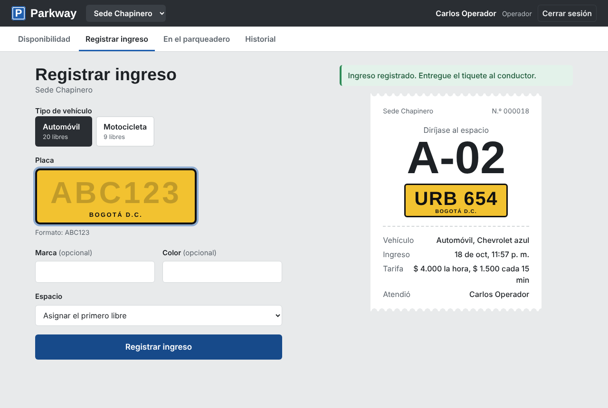
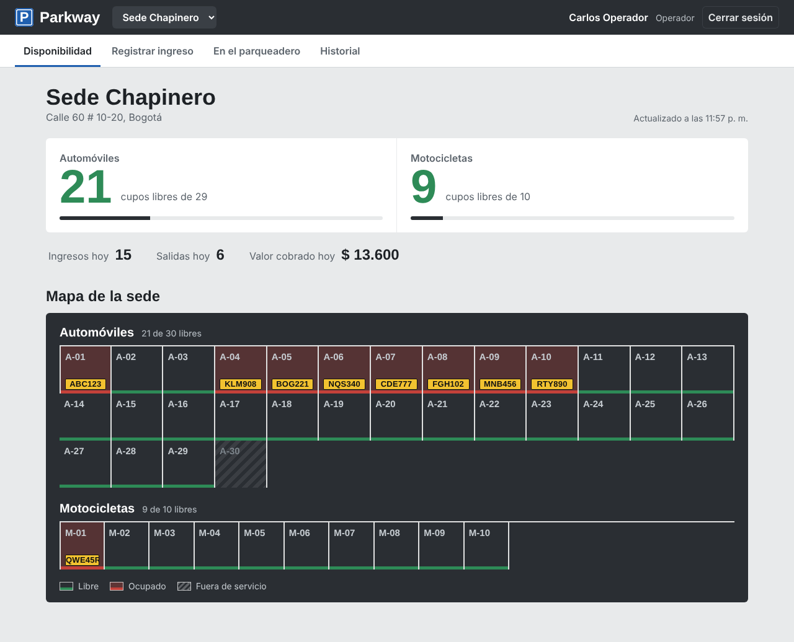
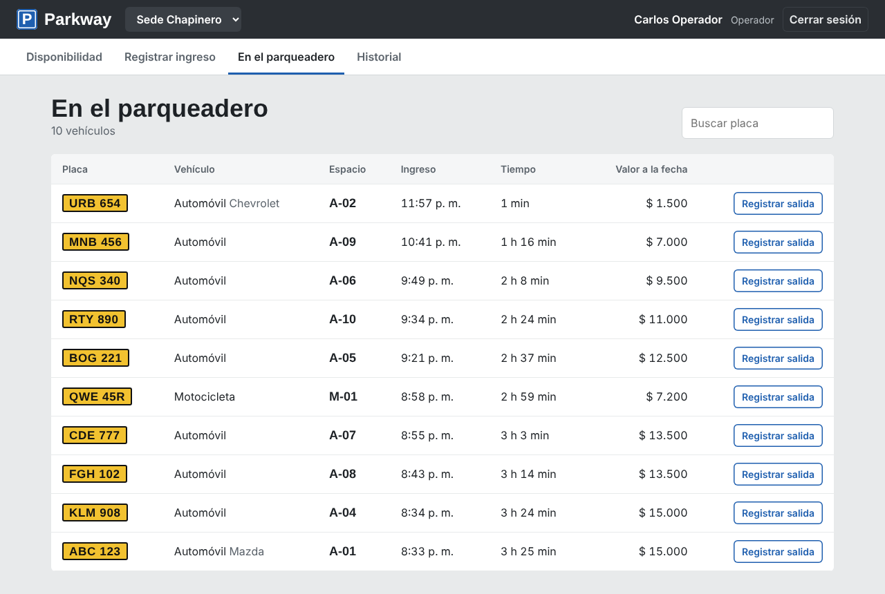
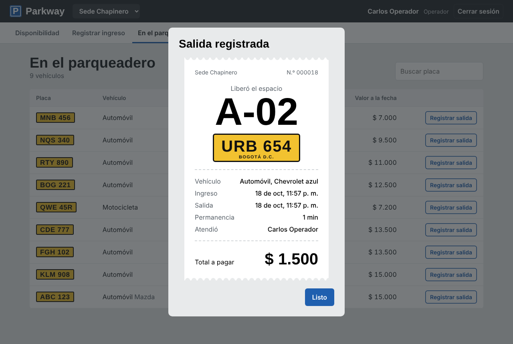
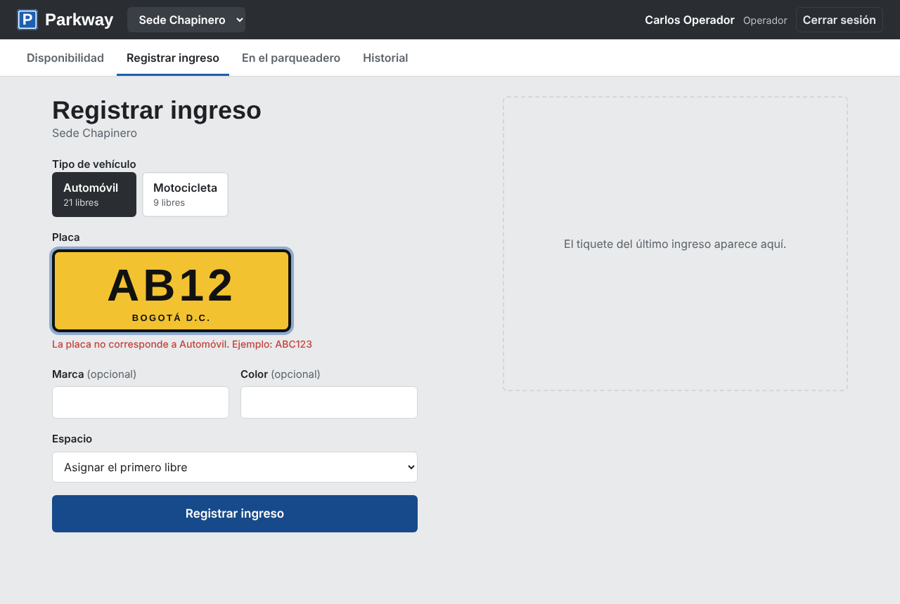
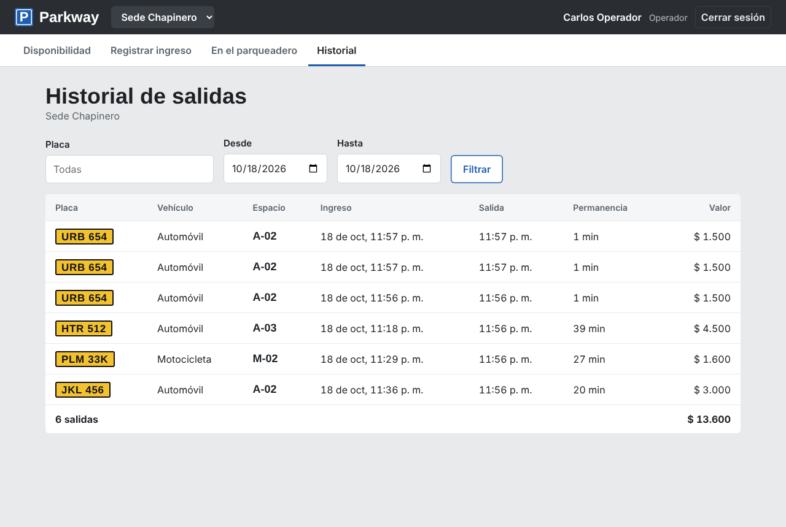
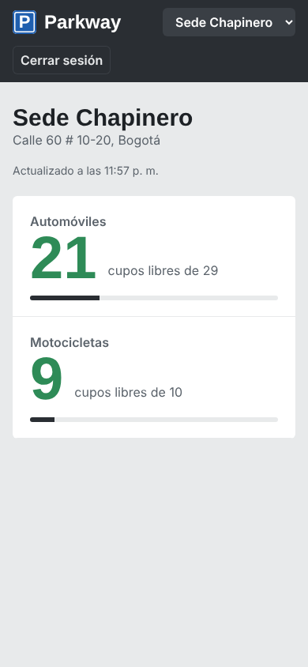

# Parkway

En la mayoría de parqueaderos el conductor llega sin saber si hay cupo. El
personal lleva el control de entradas y salidas en planillas o de memoria, lo
que genera filas en la entrada, espacios asignados dos veces y una cifra de
disponibilidad que nadie sabe con certeza.

Parkway centraliza ese control. La base de datos impide que un espacio se
ocupe dos veces y los cambios se reflejan en las pantallas de consulta y en
el panel del personal.



## Estado actual

| Funcionalidad | Requerimiento | Estado |
| --- | --- | --- |
| Inicio de sesión con JWT y control de acceso por rol | RF01 | Implementado |
| Consulta de cupos libres por sede y tipo de vehículo | RF05 | Implementado |
| Registro de ingreso con asignación automática de espacio | RF06 | Implementado |
| Registro de salida con cálculo de permanencia y tarifa | RF07 | Implementado |
| Mapa de plazas, vehículos activos e historial de salidas | RF05, RF13 | Implementado |
| Bitácora de transacciones (confirmadas y revertidas) | RF14, RNF08 | Implementado en el backend |
| Actualización de disponibilidad sin recargar la página | RF12 | Consulta cada 5 s. WebSocket en la siguiente fase |
| Pagos y comprobantes, reservas, gestión de tarifas y usuarios | RF02, RF08 a RF11 | Siguiente fase |
| Predicción de ocupación con IA | RF15 | Diseño en el documento maestro |

## Operación principal: ingreso y salida de vehículos

**Registrar ingreso (RF06).** El operador escribe la placa y elige el tipo de
vehículo. El sistema valida el formato de la placa, crea el vehículo si no
existe, toma el primer espacio libre del tipo (o el que elija el operador),
abre el registro y marca el espacio como ocupado. Todo ocurre en una sola
transacción: si un paso falla, nada queda a medias.

**Registrar salida (RF07).** El operador elige el vehículo en la lista de
activos. El sistema calcula los minutos con la hora de la base de datos,
aplica la tarifa vigente, cierra el registro y libera el espacio.

Reglas que se cumplen:

- Una placa no puede tener dos ingresos abiertos.
- Un espacio no puede quedar asignado a dos vehículos, ni con operadores
  registrando ingresos al mismo tiempo (`FOR UPDATE SKIP LOCKED` más índices
  únicos parciales en `registro_estacionamiento`).
- La placa debe coincidir con el formato del tipo: automóvil `ABC123`,
  motocicleta `ABC12D`, bicicleta código interno de 3 a 10 caracteres.
- Una placa registrada como motocicleta no puede ingresar como automóvil.
- Cada operación queda en la tabla `transaccion` con el usuario, el
  resultado y el detalle.

**Cálculo del cobro.** Horas completas por el valor de la hora, más cada
fracción de 15 minutos iniciada por el valor de la fracción. El valor de un
día nunca supera el valor día. Ejemplo para automóvil: 1 h 20 min cuesta
$4.000 + 2 × $1.500 = $7.000.

## Tecnologías

| Elemento | Valor |
| --- | --- |
| Frontend | React 18, TypeScript, Vite |
| Backend | Node.js, TypeScript, Express |
| Base de datos | PostgreSQL |
| Seguridad | JWT, contraseñas con bcrypt |
| Arquitectura | Tres capas (presentación, negocio, datos) con Gestor de transacciones |

## Estructura del repositorio

```
Parkway/
├── database/
│   ├── schema.sql                  # Tablas, claves, restricciones e índices
│   └── seed.sql                    # Datos de prueba: usuarios, sedes, 65 espacios, tarifas
├── backend/
│   ├── src/
│   │   ├── app.ts                  # Configuración de Express
│   │   ├── index.ts                # Punto de entrada de la API
│   │   ├── db/pool.ts              # Pool de conexiones a PostgreSQL
│   │   ├── transactions/           # Gestor de transacciones (BEGIN/COMMIT/ROLLBACK + bitácora)
│   │   ├── repositories/           # Acceso a datos (patrón Repository)
│   │   ├── services/               # Reglas de negocio: ingreso, salida, tarifas, sesión
│   │   ├── validators/             # Validación de datos de entrada
│   │   ├── controllers/            # Controladores REST
│   │   ├── routes/                 # Rutas Express
│   │   ├── middlewares/            # JWT, roles y manejo de errores
│   │   └── errors/                 # Errores de negocio con código HTTP
│   ├── tests/                      # Pruebas unitarias (tarifas y validaciones)
│   ├── scripts/pruebaConcurrencia.ts
│   └── .env.example
├── frontend/
│   └── src/
│       ├── pages/                  # Login, Disponibilidad, Ingreso, Activos, Historial
│       ├── components/             # Placa, Tiquete, MapaEspacios, Dialogo
│       └── lib/                    # Cliente de la API, formatos, consultas periódicas
├── docs/
│   ├── Proyecto_S8_Parkway.pdf     # Documento maestro
│   └── capturas/                   # Capturas de la interfaz
└── README.md
```

## Requisitos previos

- Node.js 18 o superior
- PostgreSQL 14 o superior
- npm

## Cómo ejecutar el proyecto

### 1. Crear y poblar la base de datos

```bash
createdb parkway
psql -d parkway -f database/schema.sql
psql -d parkway -f database/seed.sql
```

Si PostgreSQL requiere usuario y host explícitos:

```bash
createdb -h localhost -U postgres parkway
psql -h localhost -U postgres -d parkway -f database/schema.sql
psql -h localhost -U postgres -d parkway -f database/seed.sql
```

`seed.sql` usa la extensión `pgcrypto` (la crea `schema.sql`) para guardar
las contraseñas con bcrypt.

### 2. Backend

```bash
cd backend
cp .env.example .env      # Ajustar las credenciales de PostgreSQL
npm install
npm run dev               # http://localhost:3000
```

### 3. Frontend

En otra terminal:

```bash
cd frontend
npm install
npm run dev               # http://localhost:5173
```

El frontend envía las peticiones `/api` al backend del puerto 3000.

### Cuentas de prueba

| Rol | Correo | Contraseña |
| --- | --- | --- |
| Operador | operador1@parkway.test | Operador123* |
| Administrador | admin@parkway.test | Admin123* |
| Cliente | cliente1@parkway.test | Cliente123* |

El operador y el administrador registran ingresos y salidas. El cliente solo
consulta los cupos libres.

## Pruebas

```bash
cd backend
npm test                                   # Pruebas unitarias de tarifas y validaciones
npx tsx scripts/pruebaConcurrencia.ts 20   # Con el backend corriendo
```

La prueba de concurrencia envía 20 ingresos simultáneos de bicicleta a la
Sede Zona T, que tiene 3 espacios. Resultado obtenido: 3 aceptados, 17
rechazados con código 409 y ningún espacio duplicado (RNF03).

## API

| Método | Ruta | Acceso | Descripción |
| --- | --- | --- | --- |
| GET | `/api/health` | Público | Estado del servicio |
| POST | `/api/auth/login` | Público | Inicia sesión y devuelve el token |
| GET | `/api/auth/me` | Sesión | Usuario de la sesión |
| GET | `/api/catalogos/parqueaderos` | Público | Sedes |
| GET | `/api/catalogos/tipos-vehiculo` | Público | Tipos de vehículo con tarifa vigente |
| GET | `/api/estacionamiento/resumen?idParqueadero=1` | Público | Cupos por tipo de vehículo |
| GET | `/api/estacionamiento/disponibilidad?idParqueadero=1&idTipo=1` | Público | Espacios libres |
| GET | `/api/estacionamiento/espacios?idParqueadero=1` | Personal | Mapa de plazas con placa |
| GET | `/api/estacionamiento/activos?idParqueadero=1&placa=ABC` | Personal | Vehículos dentro y valor acumulado |
| GET | `/api/estacionamiento/historial?idParqueadero=1&desde=2026-10-01&hasta=2026-10-31` | Personal | Salidas registradas |
| GET | `/api/estacionamiento/totales-dia?idParqueadero=1` | Personal | Ingresos, salidas y valor del día |
| POST | `/api/estacionamiento/ingreso` | Personal | Registra un ingreso |
| POST | `/api/estacionamiento/salida/:idRegistro` | Personal | Registra una salida |

Ejemplo de ingreso:

```bash
curl -X POST http://localhost:3000/api/estacionamiento/ingreso \
  -H "Authorization: Bearer <token>" -H "Content-Type: application/json" \
  -d '{"placa":"ABC123","idTipo":1,"idParqueadero":1}'
```

Errores: 400 si un campo no es válido (con el detalle por campo), 401 sin
sesión, 403 sin permiso, 404 si la sede o el registro no existen y 409 si
una regla de negocio lo impide, por ejemplo cuando no hay espacios libres.

## Capturas

| Disponibilidad y mapa de plazas | Vehículos en el parqueadero |
| --- | --- |
|  |  |
| **Salida registrada** | **Validación de placa** |
|  |  |
| **Historial** | **Vista del cliente en el teléfono** |
|  |  |
