# Parkway

Sistema transaccional para la gestión de parqueaderos. Muestra los cupos
libres de cada sede en tiempo real, registra ingresos y salidas con cálculo
automático del cobro, permite a los clientes reservar un espacio dentro del
horario de la sede y deja cada operación en una bitácora. El administrador
crea las sedes con sus pisos, espacios, tarifas, horario y operadores. Cada
sede se ve como una maqueta 3D donde los vehículos entran y salen en tiempo
real.

Proyecto de Sistemas Transaccionales, Universidad Manuela Beltrán.
Grupo 2: Bryan Failach, Alejandro Castellanos y Brayan Bello.

El documento maestro final del proyecto está en
[docs/Documento_Maestro_Sistemas_Transaccionales_Parkway_Grupo2.pdf](docs/Documento_Maestro_Sistemas_Transaccionales_Parkway_Grupo2.pdf).

El mismo sistema es también el proyecto de **Sistemas Distribuidos**. La
versión distribuida corre con `docker compose up`: un gateway Nginx, dos
réplicas del backend, un microservicio de eventos, Redis, RabbitMQ y
PostgreSQL con réplica. Vea [Arquitectura distribuida](#arquitectura-distribuida)
y el [manual de despliegue](docs/distribuidos/MANUAL_DESPLIEGUE.md).

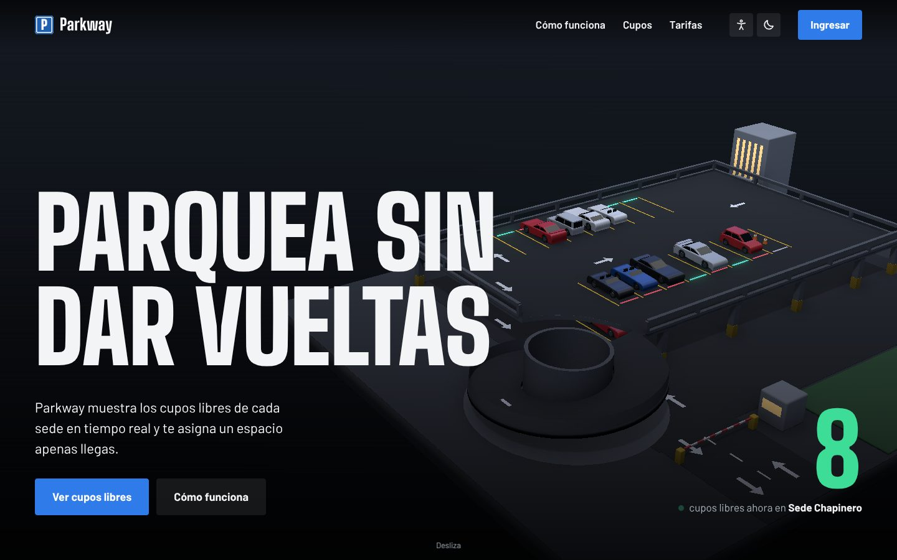

## El problema

En la mayoría de parqueaderos el conductor llega sin saber si hay cupo. El
personal lleva el control de entradas y salidas en planillas o de memoria, lo
que genera filas en la entrada, espacios asignados dos veces y una cifra de
disponibilidad que nadie sabe con certeza.

Parkway centraliza ese control. La base de datos impide que un espacio se
ocupe dos veces y cada cambio aparece en las pantallas de clientes y personal
en pocos segundos.

## Qué puede hacer cada usuario

| Rol | Funciones |
| --- | --- |
| Visitante | Ver los cupos libres por sede, el recorrido de cómo funciona y calcular el cobro. |
| Cliente | Crear su cuenta, registrar sus vehículos (las bicicletas reciben un código BICI) y ver en qué sede y espacio está cada uno, reservar un espacio por 30 minutos dentro del horario de la sede, ver su vehículo dentro con el valor acumulado, configurar avisos de tiempo y dinero y consultar su historial. |
| Operador | Registrar ingresos y salidas en las sedes que tiene asignadas, y cobrar la salida en efectivo, tarjeta o transferencia con su comprobante. Al digitar una placa conocida, el formulario trae la marca y el color guardados. Ve las reservas en camino, los vehículos dentro, el plano 3D y 2D y el historial con filtros. |
| Administrador | Todo lo del operador en todas las sedes, más la creación y edición de sedes (espacios, tarifas, horario, espacios fuera de servicio y operadores), el cierre de caja, la anulación de pagos con su motivo, la gestión de usuarios (crear, editar, asignar turno y sedes, inactivar), los reportes con exportación a CSV y la bitácora de transacciones. |

Todos los usuarios pueden cambiar entre modo oscuro y claro y ajustar la
accesibilidad: tamaño del texto, alto contraste, movimiento reducido, letra de
lectura fácil, símbolos de estado en el plano y plano 2D en lugar del 3D.

El detalle de cada pantalla, con capturas, está en
[docs/FRONTEND.md](docs/FRONTEND.md).

## Estado de los requerimientos

| Funcionalidad | Requerimiento | Estado |
| --- | --- | --- |
| Inicio de sesión con JWT, control de acceso por rol y creación de cuenta de cliente | RF01 | Implementado |
| Estado e historial del cliente (vehículo dentro, valor acumulado, visitas) | RF03 | Implementado |
| Vehículos del cliente: registrar, consultar y quitar | RF04 | Implementado |
| Consulta de cupos libres por sede y tipo, con plano 3D y 2D, filtro por piso y animación de ingresos y salidas | RF05 | Implementado |
| Registro de ingreso con asignación automática de espacio | RF06 | Implementado |
| Registro de salida con cálculo de permanencia y tarifa | RF07 | Implementado |
| Reservas: reservar, cancelar, expirar a los 30 minutos, vista del operador | RF10 | Implementado |
| Actualización de la disponibilidad en tiempo real por WebSocket, sin recargar la página | RF12 | Implementado |
| Historial de salidas y totales del día | RF13 | Implementado |
| Reportes de ocupación por franja horaria, rotación por espacio e ingresos por periodo y sede, exportables a CSV | RF13 | Implementado |
| Bitácora de transacciones con filtros por usuario, operación, entidad, resultado y fecha | RF14, RNF08 | Implementado |
| Gestión de sedes: pisos, espacios por piso, tarifas por sede, horario, fuera de servicio y operadores asignados | RF11 | Implementado |
| Horario de atención: no se aceptan reservas fuera del horario | RF10 | Implementado |
| Notificaciones configurables de tiempo, valor y vencimiento de la reserva | RF03 | Implementado |
| Gestión de usuarios: crear, consultar, editar e inactivar clientes, operadores y administradores, con turno y sedes | RF02 | Implementado |
| Pago en efectivo, tarjeta o transferencia con comprobante de número único, en la misma transacción de la salida | RF08 | Implementado |
| Anulación de pagos con motivo, sin borrar el registro original, y nuevo cobro | RF09 | Implementado |
| Predicción de ocupación con IA: próximas 24 horas con rango de confianza (Prophet) y la hora siguiente corregida por una red neuronal | RF15 | Implementado |

## Tecnologías

| Elemento | Valor |
| --- | --- |
| Frontend | React 18, TypeScript, Vite; aplicación instalable (PWA) en Android, iPhone y escritorio |
| 3D | Three.js con React Three Fiber, Drei y postprocesado (oclusión ambiental y bloom) |
| Backend | Node.js, TypeScript, Express |
| Base de datos | PostgreSQL |
| Tiempo real | WebSocket (`ws`) con avisos de PostgreSQL (`LISTEN/NOTIFY`) |
| Seguridad | JWT, contraseñas con bcrypt |
| Arquitectura | Tres capas (presentación, negocio, datos) con Gestor de transacciones |

## Cómo ejecutarlo

Requisitos: Node.js 18 o superior y PostgreSQL 14 o superior. En Windows,
sigue la guía paso a paso de [docs/INSTALACION_WINDOWS.md](docs/INSTALACION_WINDOWS.md).

**1. Base de datos** (desde la carpeta principal del proyecto)

```bash
createdb -U postgres parkway
psql -U postgres -d parkway -f database/schema.sql
psql -U postgres -d parkway -f database/seed.sql
psql -U postgres -d parkway -f database/demo.sql   # opcional, recomendado para presentar
```

`demo.sql` simula 12 semanas de operación hasta ayer, con el patrón de cada
sede: Chapinero es de oficinas (llegan temprano, se quedan el día y el fin
de semana baja a la mitad) y Zona T es comercial (almuerzo, tarde y noche,
con más movimiento el viernes y el fin de semana). Respeta los festivos, la
capacidad de cada sede y que un vehículo no esté en dos lugares a la vez.
Hoy ocupa cerca del 60 % de los espacios, registra salidas del día, crea dos
reservas activas que vencen a los 18 minutos y llena la bitácora. Así los
reportes, el historial y el pronóstico tienen datos con sentido. Tarda unos
segundos y se puede ejecutar varias veces para reiniciar la demostración.

**2. Backend** (una terminal)

```bash
cd backend
cp .env.example .env      # en Windows: copy .env.example .env. Poner la contraseña de PostgreSQL en DB_PASSWORD
npm install
npm run dev               # http://localhost:3000
```

**3. Frontend** (otra terminal)

```bash
cd frontend
npm install
npm run dev               # http://localhost:5173
```

### Publicarlo en internet

El repositorio incluye `render.yaml` para desplegarlo en Render con un solo
servicio (API y frontend) y una base PostgreSQL. Los pasos están en
[docs/DESPLIEGUE.md](docs/DESPLIEGUE.md).

### Cuentas de prueba

| Rol | Correo | Contraseña | Datos |
| --- | --- | --- | --- |
| Operador | operador1@parkway.test | Operador123* | |
| Administrador | admin@parkway.test | Admin123* | |
| Cliente | cliente1@parkway.test | Cliente123* | Carro ABC123 |
| Cliente | cliente2@parkway.test | Cliente123* | Moto XYZ78D |

También se puede crear un cliente nuevo desde "Crea una para reservar" en la
pantalla de ingreso.

## App en el celular (PWA)

Parkway se instala como aplicación desde el navegador, sin código para
Android ni iOS: es el mismo frontend en React y el mismo servidor. Queda con
su ícono en la pantalla de inicio y se abre a pantalla completa, sin la
barra del navegador.

- **Android (Chrome) y computador (Chrome o Edge):** el botón **Instalar la
  app** de la portada, o el ícono del celular en la barra del panel, abre el
  diálogo de instalación. También funciona desde el menú del navegador:
  "Instalar aplicación" o "Agregar a la pantalla principal".
- **iPhone (Safari) y Firefox en Android:** estos navegadores no avisan que
  la app se puede instalar, así que el mismo botón explica los pasos: en
  Safari, Compartir y Agregar a inicio; en Firefox, el menú de tres puntos y
  Agregar a la pantalla de inicio.

La pieza que lo hace posible es `frontend/public/manifest.webmanifest`
(nombre, íconos y colores) y `frontend/public/sw.js`, un *service worker*
que guarda la aplicación para que abra aunque no haya internet. La API y el
WebSocket nunca se guardan: los cupos, los pagos y los datos de los usuarios
siempre vienen del servidor. Sin conexión aparece una franja que lo avisa, y
todo se actualiza solo cuando vuelve. Cada despliegue en Render llega a las
apps instaladas al abrirlas, sin reinstalar.

El documento maestro deja fuera del alcance la aplicación móvil nativa; la
PWA no lo contradice, porque es la misma aplicación web, ahora instalable.

| Instalar desde la portada | Sin conexión |
| --- | --- |
| 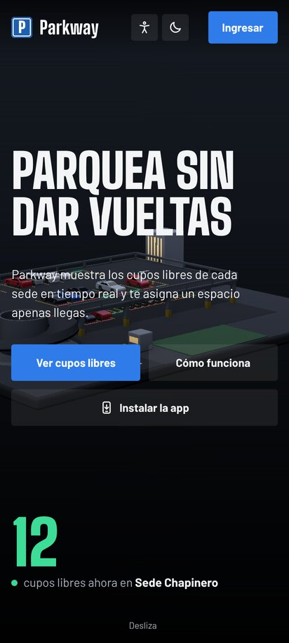 |  |

## Reglas de negocio

**Ingreso (RF06).** El operador digita la placa y elige el tipo de vehículo.
El sistema valida el formato, crea el vehículo si no existe, toma el espacio
reservado o el primer espacio libre del tipo, abre el registro y marca el
espacio como ocupado. Todo ocurre en una sola transacción: si un paso falla,
nada queda a medias.

**Salida y pago (RF07 y RF08).** El sistema calcula los minutos con la hora
de la base de datos y aplica la tarifa vigente. El operador elige el medio
de pago y confirma. En una sola transacción se cierra el registro, se libera
el espacio, se registra el pago como APROBADO y se emite el comprobante con
número consecutivo (`PKW-2026-000123`). Si algo falla, no queda una salida
sin pago ni un pago sin salida.

- **Efectivo:** el operador digita lo recibido (o lo deja vacío si es el
  valor exacto) y el sistema calcula el cambio. Si el valor subió mientras
  la pantalla estaba abierta y lo recibido no alcanza, la salida se rechaza
  y dice cuánto falta.
- **Tarjeta o transferencia:** el operador digita el número de aprobación
  del datáfono o la referencia de la transferencia. Los pagos electrónicos
  se simulan, como define el alcance del documento.
- **Idempotencia:** la misma referencia no se puede registrar dos veces para
  el mismo medio de pago (restricción `uq_pago_referencia`), y un registro
  no puede tener dos pagos aprobados (índice único parcial
  `ux_pago_aprobado_por_registro`). Diez cobros simultáneos de la misma
  salida dejan un solo pago.

**Anulación (RF09).** El administrador anula un pago con un motivo de al
menos 10 caracteres. El pago no se borra: queda ANULADO con el motivo, quién
lo anuló y cuándo, y el comprobante se ve tachado. Después puede cobrar de
nuevo esa visita con otro pago y otro comprobante. Cada pago, anulación y
nuevo cobro queda en la bitácora (RNF08). Los reportes, el cierre de caja y
los totales del día cuentan solo los pagos aprobados.

| Salida y pago | Comprobante | Pagos y cierre de caja | Anular un pago |
| --- | --- | --- | --- |
| 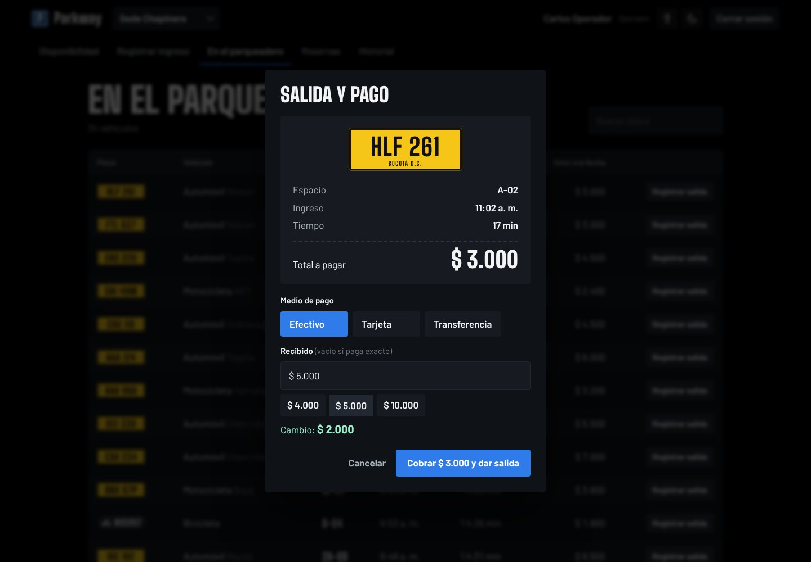 | 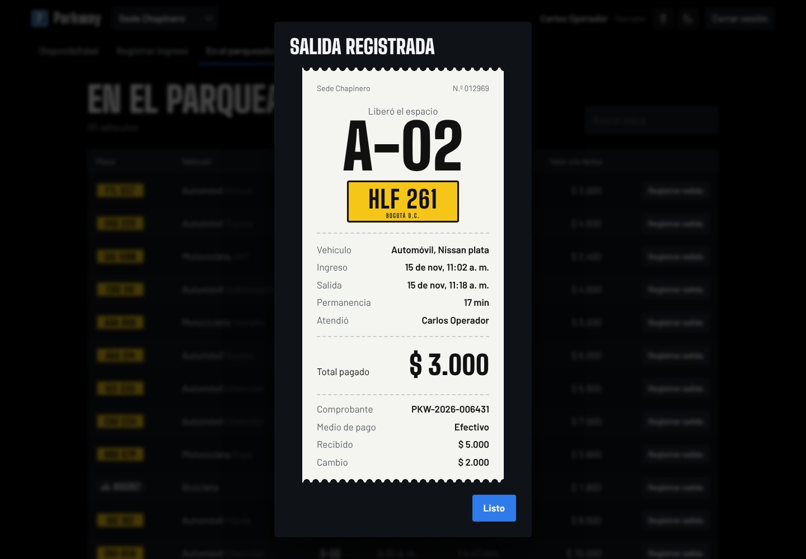 | 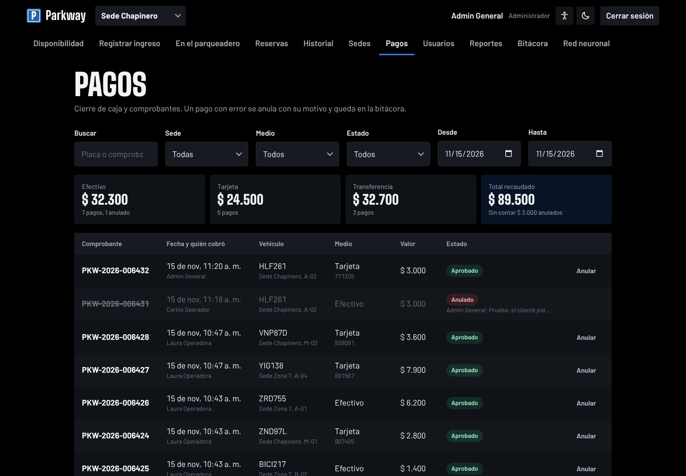 | 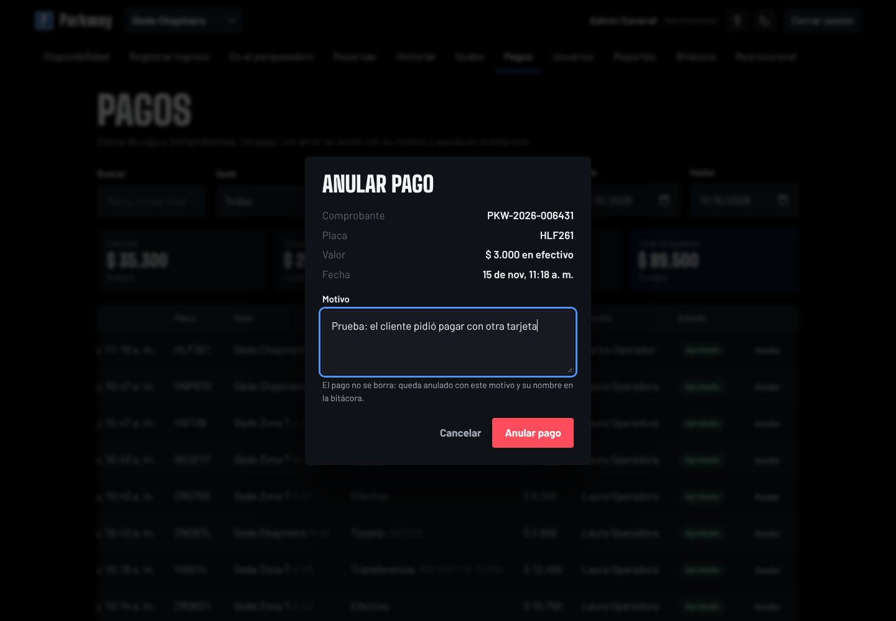 |

**Cobro.** Horas completas por el valor de la hora, más cada fracción de 15
minutos iniciada por el valor de la fracción. El cobro de un día nunca supera
el valor día. Ejemplo para automóvil: 1 h 20 min cuesta $4.000 + 2 × $1.500 =
$7.000.

**Datos guardados del vehículo.** Cuando el operador digita una placa que ya
existe, el formulario de ingreso trae la marca y el color guardados y dice de
quién es el vehículo. El operador puede cambiarlos; al registrar, el vehículo
queda con los datos que confirmó.

**Bicicletas.** No tienen placa. Al agregar una bicicleta, el cliente recibe
un código único (BICI001, BICI002...) que le dice al operador al llegar. En el
ingreso, el operador busca el código; si la bicicleta llega sin registro, el
sistema genera uno nuevo.

**Límites de una sede.** Pensados para los parqueaderos de Bogotá: por piso,
hasta 150 automóviles, 80 motocicletas y 60 bicicletas; en toda la sede,
hasta 600, 300 y 200, y como máximo 800 espacios. El formulario recomienda
cupos de bicicleta equivalentes al 10 % de los de automóvil (mínimo 12 si hay
menos de 120), como pide la Ley 1811 de 2016 a los edificios públicos.

**Pisos.** Una sede puede tener de 1 a 6 pisos, unidos por una rampa en
espiral. El ingreso asigna primero los espacios del piso 1 y luego los de los
pisos de arriba. En los pisos 2 en adelante el código del espacio lleva el
número del piso: 2A-01 es el automóvil 01 del piso 2.

**Usuarios (RF02).** El administrador crea las cuentas de clientes,
operadores y administradores. El documento y el correo son únicos. El
personal lleva turno (día o noche) y cada operador, las sedes donde trabaja.
Los usuarios no se borran: se inactivan o se bloquean, y así conservan su
historial. Cada petición confirma en la base de datos que el usuario sigue
activo y toma su rol actual, de modo que inactivar una cuenta o cambiarle el
rol surte efecto de inmediato y no cuando vence el token. Al inactivar a un
cliente se cancela su reserva activa y se libera el espacio. El
administrador no puede cambiar su propio rol ni desactivarse, y siempre
queda al menos un administrador activo.

**Sedes y operadores.** Cada sede tiene sus propias tarifas y su horario por
día de la semana. Un operador solo puede registrar ingresos y salidas en las
sedes que el administrador le asignó. Al reducir los espacios de una sede se
quitan los libres de número más alto que nunca se usaron; los que tienen
historial se conservan.

**Horario.** El cliente no puede reservar si la sede está cerrada o si cierra
antes de que venza la reserva.

**Reservas (RF10).** El cliente reserva con uno de sus vehículos y el sistema
aparta el primer espacio libre de ese tipo, que queda RESERVADO y no se cuenta
como libre. Tiene 30 minutos para llegar (`RESERVA_MINUTOS` en `backend/.env`).
Al llegar, el operador digita la placa y el vehículo entra a ese espacio,
aunque no queden cupos libres. Si no llega, la reserva expira, el espacio se
libera y la expiración queda en la bitácora. Si el vehículo entra a otra sede,
la reserva se cancela.

**Integridad.**

- Una placa no puede tener dos ingresos abiertos.
- Un espacio no puede quedar asignado a dos vehículos, ni con varios
  operadores registrando ingresos al mismo tiempo (`FOR UPDATE SKIP LOCKED` e
  índices únicos parciales).
- La placa debe coincidir con el formato del tipo: automóvil `ABC123` y
  motocicleta `ABC12D`. Las bicicletas usan el código `BICI001` que asigna el
  sistema y no llevan marca.
- Los datos se validan en el formulario y otra vez en el backend.
- Cada operación queda en la tabla `transaccion` con el usuario, el resultado
  y, si falló, el motivo.

## Tiempo real (RF12)

Las pantallas cambian en el momento en que la portería confirma una
operación, sin recargar la página:

1. Un trigger en la tabla `espacio` (`tr_espacio_tiempo_real`) envía un aviso
   con `pg_notify` cada vez que cambia el estado de un espacio. PostgreSQL lo
   entrega solo cuando la transacción hace COMMIT: una operación revertida
   no avisa.
2. El backend escucha el canal con `LISTEN` y reenvía el aviso
   `{"tipo":"espacios","sede":1}` a las pantallas conectadas por WebSocket en
   `/api/tiempo-real`.
3. Cada pantalla abierta en esa sede vuelve a pedir sus datos a la API:
   cupos, plano 3D, vehículos dentro, reservas y el estado del cliente.

Cubre todo cambio de espacio, también la expiración automática de las
reservas, y funciona aunque el servicio corra en varios nodos, porque el
aviso sale de la base de datos. El aviso solo dice qué sede cambió; las
placas y los datos del cliente siguen saliendo de la API con su token.
Entre el COMMIT y el aviso pasan unos 150 ms.

Si la conexión se cae, el frontend reintenta con espera creciente y mientras
tanto vuelve a consultar cada 5 a 15 segundos, como antes. Con la conexión
abierta solo consulta una vez por minuto, por si se pierde un aviso. En
Disponibilidad se ve el estado: **En vivo** o **Reconectando**.

En una base creada antes de esta versión, agregue el trigger sin borrar
datos con `psql -U postgres -d parkway -f database/migracion_tiempo_real.sql`.
Si falta, el backend lo indica al arrancar y las pantallas siguen
consultando cada pocos segundos.

## Reportes (RF13)

El administrador elige la sede (o todas), el tipo de vehículo y el periodo,
de un día a un año, con atajos para hoy, 7 días, 30 días, este mes y el mes
anterior. Hay tres reportes:

- **Ocupación por franja horaria:** la ocupación promedio y la máxima de cada
  hora del día, separando lunes a viernes de los fines de semana y festivos,
  y las llegadas por hora. Señala la hora pico.
- **Rotación por espacio:** cuántos vehículos usó cada espacio, cuántos por
  día, qué parte del tiempo estuvo ocupado y cuánto se cobró en él. Muestra
  el espacio más usado y los que no se usaron.
- **Ingresos por periodo y sede:** salidas, valor cobrado, valor promedio por
  salida y permanencia, agrupados por día, semana o mes. Incluye los
  periodos sin movimiento para que la serie no tenga huecos.

La ocupación de cada hora cuenta los vehículos dentro al inicio de la hora
sobre los espacios en servicio. Los ingresos son los pagos aprobados, por
medio de pago; un pago anulado deja de contar.

**Descargar CSV** guarda el reporte que se está viendo. El archivo usa UTF-8,
punto y coma y coma decimal para abrirse con doble clic en Excel en español.
Las celdas que empiezan por `=`, `+`, `-` o `@` llevan un apóstrofo para que
Excel no las tome como fórmulas.

| Ocupación por franja | Rotación por espacio | Ingresos por periodo |
| --- | --- | --- |
| 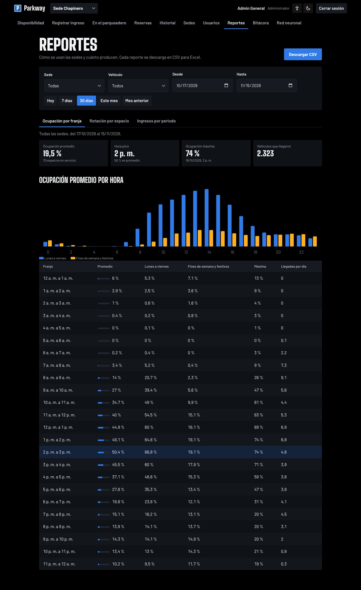 | 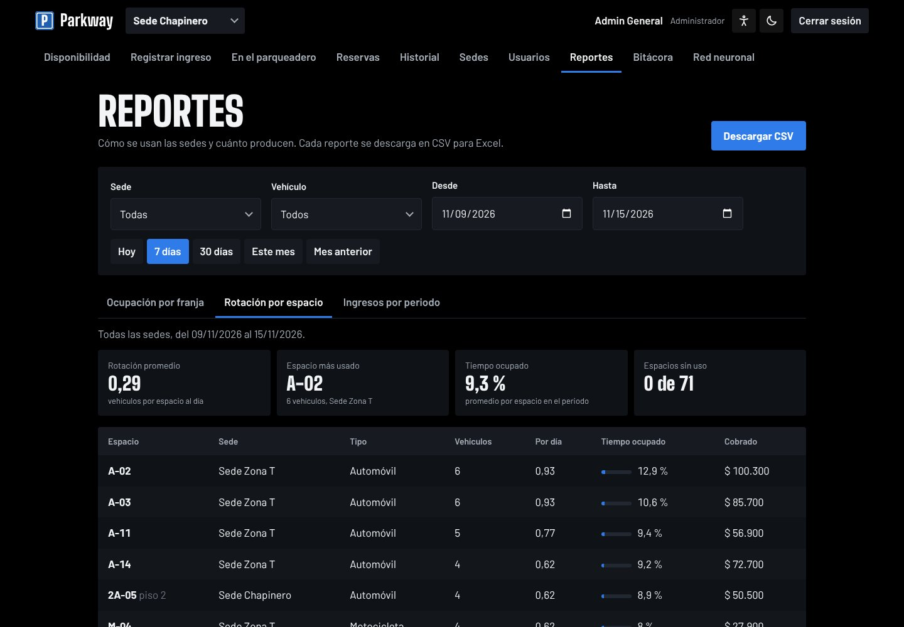 | 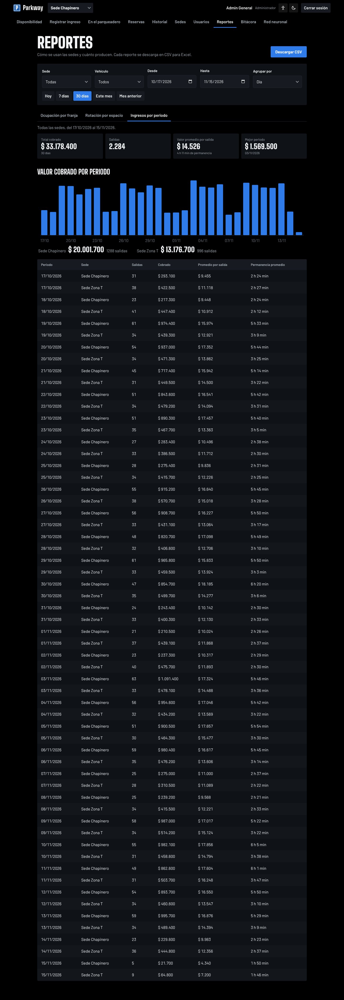 |

## Pronóstico de las próximas 24 horas (RF15)

Prophet estima la ocupación de cada sede para cada una de las próximas horas,
con un rango de confianza del 80 % (sección 13 del documento maestro). Usa la
estacionalidad diaria (una curva para entre semana y otra para fines de
semana y festivos), la semanal y los festivos de Colombia.

```bash
pip install -r ia/requirements.txt
python ia/pronostico_prophet.py      # todas las sedes; --sede 1 para una
```

El script arma la serie de ocupación por hora de las últimas 12 semanas con
los registros de entrada y salida. Si una sede todavía no tiene ocho semanas
de registros, el mínimo de la ficha técnica, usa una serie simulada con el
mismo patrón de la red neuronal y lo deja anotado. Evalúa el modelo con las
dos últimas semanas reservadas y guarda en `prediccion_ocupacion` las
próximas 48 horas (modelo `PROPHET`), así el cálculo de las 2:00 a. m. sirve
el día completo. Las métricas quedan en `modelo_pronostico`.

Resultado con la historia de 12 semanas de `demo.sql`: MAPE de 16,5 % en
Sede Chapinero, que cumple la meta de menos de 20 %, y de 22,9 % en Sede
Zona T, que no la cumple. El error medio es de 4 a 5 puntos porcentuales y
cerca del 80 % de los valores reales cae dentro del rango. El MAPE no cuenta
las horas con menos de 10 % de ocupación, porque dividir por casi cero lo
infla. Sin esa historia (una base solo con `seed.sql`), el script usa la
serie simulada y lo indica.

**Cada noche.** El flujo `.github/workflows/pronostico.yml` lo ejecuta en
GitHub Actions a las 2:17 a. m. contra la base de producción. Necesita el
secreto `DATABASE_URL` (ver [docs/DESPLIEGUE.md](docs/DESPLIEGUE.md)).

**Prophet y la red trabajan juntos** (sección 14.1). Prophet solo conoce el
calendario y el histórico; la red sabe cómo está la sede ahora. La API toma
la estimación de la red para la hora siguiente y suma la diferencia a la
curva de Prophet, una diferencia que pierde 30 % de peso cada hora. Así un
domingo con la sede llena no aparece vacío solo porque los domingos suelen
estarlo.

En **Disponibilidad** se ve la gráfica: la ocupación esperada, el rango de
confianza, la curva original de Prophet y las horas en que la sede está
cerrada. Arriba resume la hora con más cupo en las próximas 12 horas, la
hora pico y cuántas horas estará casi llena.

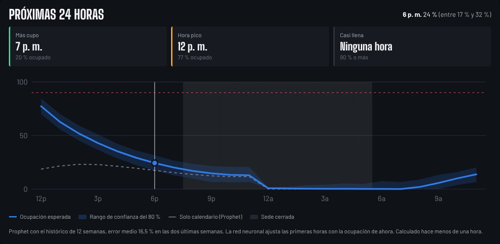

## Red neuronal de ocupación

Un perceptrón multicapa 6-8-1 estima qué porcentaje de la sede estará ocupado
dentro de una hora (sección 14 del documento maestro). Sus entradas salen de
datos que el sistema ya registra: hora, día, festivo, ocupación actual,
ocupación de hace siete días y reservas en camino.

```bash
pip install -r ia/requirements.txt
python ia/entrenar_red.py --grafica   # entrena, muestra el error y guarda los pesos
```

El script escribe `backend/src/ia/pesos_red.json`. La API hace el cálculo en
Node.js con esos pesos, así que Python solo hace falta para reentrenar.
Resultado actual con 12 semanas de datos simulados: error medio de 2,67
puntos porcentuales, frente a 9,75 del modelo ingenuo (repetir la ocupación de
hace una semana).

Dónde se ve:

- **Administrador, pestaña Red neuronal:** las tres capas con la señal que pasa
  por cada neurona, las métricas y un simulador para mover cada entrada.
- **Cliente, al reservar:** la ocupación esperada. Si pasa del 90 % sugiere la
  sede con menos ocupación esperada. Nunca bloquea la reserva.
- **Disponibilidad:** la ocupación esperada de la sede o del tipo de vehículo elegido.

Cada predicción queda en la tabla `prediccion_ocupacion`. En una base creada
antes de esta versión, agréguela sin borrar datos con
`psql -U postgres -d parkway -f database/migracion_prediccion.sql`.

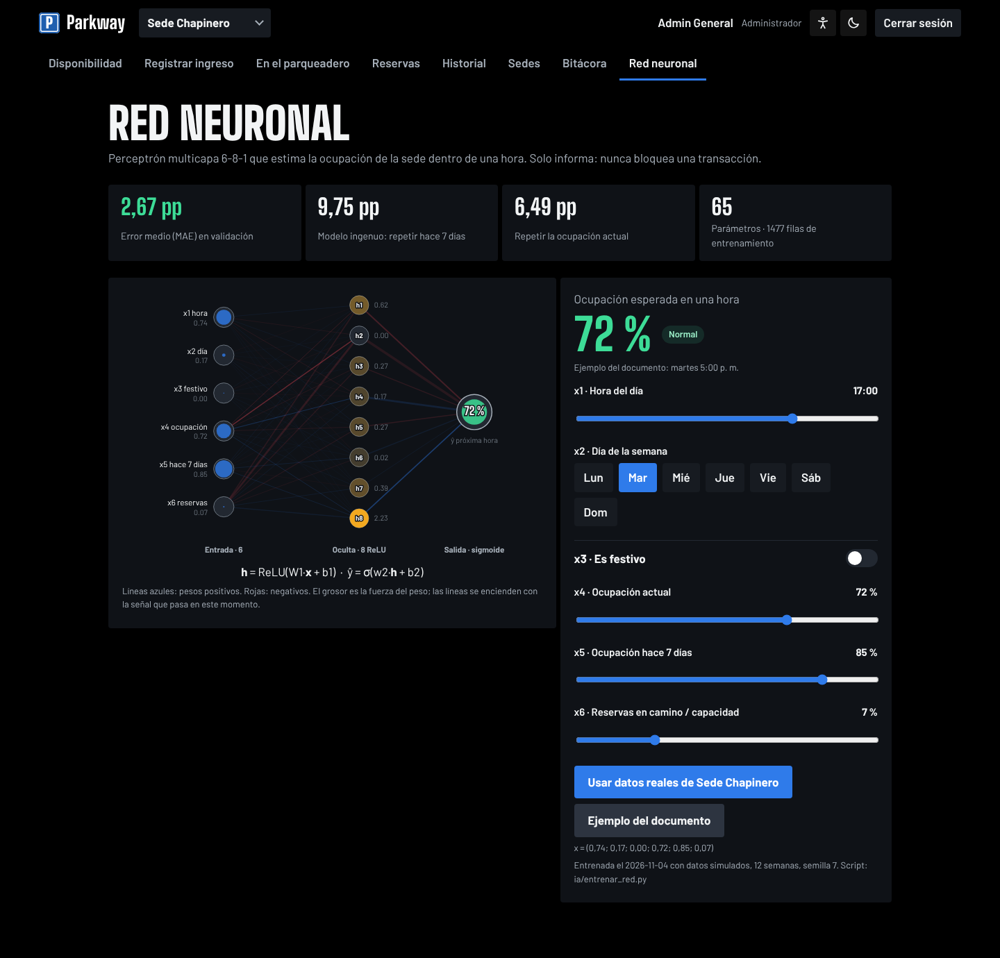

## Pruebas

```bash
cd backend
npm test                       # 66 pruebas unitarias, sin base de datos
npm run test:integracion       # 39 pruebas de los servicios contra la base parkway_test
npm run cobertura              # las 105 con la cobertura de src/services (mínimo 60 %)
npm run prueba:concurrencia    # RNF03, con el backend corriendo
npm run prueba:carga           # RNF02, con el backend compilado corriendo
```

| Requerimiento | Criterio | Resultado |
| --- | --- | --- |
| RNF03 Concurrencia | 50 ingresos simultáneos sobre 10 espacios: 10 aceptados, 40 rechazados, sin duplicados | Cumple: 10 aceptados, 40 rechazados, bitácora con 10 confirmados y 40 revertidos. 20 cobros simultáneos de una salida dejan un solo pago |
| RNF02 Rendimiento | Con 100 usuarios, p95 de consultas < 2 s y de ingresos < 3 s | Cumple: p95 de 11 ms en consultas y 37 ms en ingresos, sin errores en 26.600 solicitudes |
| RNF07 Mantenibilidad | Cobertura de al menos 60 % en servicios | Cumple: 95,6 % de líneas, 84,4 % de ramas |

Las pruebas de integración reconstruyen `parkway_test` desde `schema.sql` y
`seed.sql`, y se niegan a correr sobre una base cuyo nombre no termine en
`_test`. El flujo `.github/workflows/pruebas.yml` las corre con la cobertura
en cada push a `main`. El detalle de cada prueba, sus resultados y sus
limitaciones está en [docs/PRUEBAS.md](docs/PRUEBAS.md).

## Arquitectura distribuida

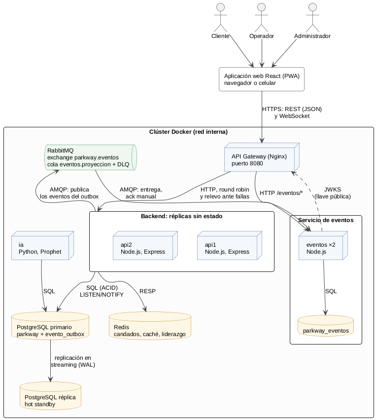

| Mecanismo | Dónde está | Qué resuelve |
|---|---|---|
| API Gateway con balanceo y relevo | `despliegue/gateway/nginx.conf` | Un punto de entrada; si una réplica cae, la otra atiende |
| Réplicas sin estado | `docker-compose.yml` (`api1`, `api2`) | La sesión viaja en el token; cualquier réplica atiende cualquier petición |
| Patrón outbox | `backend/src/distribuido/outbox.ts`, `database/migracion_distribuida.sql` | El evento se guarda en la misma transacción del negocio y no se pierde si RabbitMQ cae |
| Bus de eventos | RabbitMQ, exchange `parkway.eventos` | Comunicación asíncrona y desacoplada entre servicios |
| Microservicio de eventos | `servicios/eventos` | Consumidor idempotente con cola de mensajes muertos y base propia |
| Bloqueo distribuido, caché y liderazgo | `backend/src/distribuido/redis.ts` | Serializa operaciones sobre la misma placa entre nodos y reparte las consultas públicas |
| Circuit breaker | `backend/src/distribuido/circuitBreaker.ts` | Aísla a Redis o RabbitMQ cuando fallan, sin detener el sistema |
| JWT ES256 y JWKS | `backend/src/distribuido/llaves.ts`, `/.well-known/jwks.json` | Otros servicios verifican los tokens sin conocer ningún secreto |
| Réplica de PostgreSQL | `despliegue/postgres` | Copia en espera para relevo manual; la API responde 503 mientras la base no está |

Todo se activa con variables de entorno (`REDIS_URL`, `RABBITMQ_URL`,
`OUTBOX_HABILITADO`, `JWT_PRIVATE_KEY_FILE`). Sin ellas, el backend funciona
como antes, en un solo nodo, y así sigue publicado en Render.

Pruebas de la arquitectura distribuida (11 escenarios, con caída de réplicas,
de Redis, de RabbitMQ, del servicio de eventos y de la base):

```bash
cd backend
API_URL=http://localhost:8080 npx tsx scripts/pruebaDistribuida.ts
```

Los resultados de la última corrida están en
[docs/distribuidos/evidencias](docs/distribuidos/evidencias).

## Avisos en la plataforma

Cada operación importante que se confirma (ingreso, salida, reserva, cancelación,
reserva vencida, pago anulado, cobro nuevo y cambio de estado de un espacio)
publica un aviso por `pg_notify`. Llega a todas las réplicas y cada una lo
reenvía por WebSocket sin datos personales; la pantalla pide el detalle a la
API con su sesión.

| Quién | Qué recibe |
|---|---|
| Operador y administrador | Ingresos con QR, ingresos y salidas de otros, reservas nuevas, canceladas y vencidas, ocupación alta (90 %) y sede llena por tipo de vehículo, pagos anulados, cobros nuevos y espacios fuera de servicio. Las acciones propias no se avisan. Se eligen con la campana de la barra. Los importantes se quedan en pantalla hasta cerrarlos. |
| Cliente | Entrada y salida de su vehículo, tiempo y valor acumulado, aviso al pasar un monto y antes de que venza la reserva (ya existían), y ahora también reserva vencida, pago anulado y cobro nuevo. |

## Funciones de la propuesta

| Función | Cómo funciona |
|---|---|
| Topes tarifarios (Decreto 026 de 2026) | **El cobro de cada visita nunca supera el tope por minuto × los minutos de permanencia**, aunque la tarifa cobre por fracciones o haya quedado por encima del tope (por ejemplo, 5 minutos en automóvil: $1.150, no la fracción de $1.500). El valor que ven el operador y el cliente mientras el vehículo está dentro aplica la misma regla. Además, ninguna tarifa activa puede superar el tope en su tramo (la hora hasta 60 veces el tope, la fracción hasta 15 y el día hasta 1.440): el formulario no deja escribir más, el backend responde 422 y la base de datos la rechaza con el trigger `tr_tarifa_tope`. Topes: automóvil $230 ($253 con Sello Oro), motocicleta $161 ($177) y bicicleta $10 ($0). El administrador marca el Sello Oro al editar la sede, ve los máximos junto a las tarifas y, en *Sedes*, un aviso con las tarifas que hoy superan el tope. |
| Autorización de datos (Ley 1581 de 2012) | La cuenta de cliente solo se crea con la casilla de autorización marcada, y la autorización se guarda en la misma transacción. Las comunicaciones son opcionales y se pueden revocar desde *Notificaciones*. A las cuentas creadas antes de la política se les pide la autorización al iniciar sesión. Cada decisión queda en `consentimiento_datos` con la versión de la política. |
| Entrada con QR | El operador muestra el QR de la sede (*Registrar ingreso*, botón *Mostrar QR de entrada*). El cliente lo escanea con la cámara del celular o, si ya está en Parkway, con el botón *Escanear QR de entrada* de *Mi parqueo*; elige su vehículo y entra. Usa la misma transacción del operador; el flujo por placa no cambia. Al confirmarse, el QR del operador se oculta y aparece el vehículo registrado (placa, tipo, marca, color, cliente y espacio) para que el operador **verifique que es el que llegó**: si coincide, queda verificado; si no, lo anula con un motivo, sin cobro, y el espacio se libera. Los ingresos con QR sin verificar se marcan en *En el parqueadero*. Por seguridad el QR vale 2 minutos (`QR_MINUTOS`) y la pantalla del operador lo renueva sola, así que una foto del código no sirve más tarde; al escanearlo a tiempo, el cliente tiene 5 minutos para confirmar. En el historial el ingreso aparece como *Autoservicio (QR)*. |
| Vehículo mal registrado | Los formatos de placa de carro, moto y bicicleta no se cruzan, así que un tipo equivocado siempre llega con una placa equivocada; la corrección pide las dos. **Transparencia:** el aviso de entrada y *Mi parqueo* le dicen al cliente con qué tipo y tarifa quedó registrado. **Vehículo dentro:** en *En el parqueadero*, botón *Corregir*: cambia placa, tipo, espacio (el primero libre del tipo correcto) y tarifa en una transacción (`CORREGIR_INGRESO`); la salida se cobra con la tarifa correcta. **Visita ya pagada:** en *Pagos*, *Corregir cobro* (administrador) recalcula con la tarifa y el tope del tipo correcto; solo se permite si el valor no sube. Se anula el pago, se emite uno nuevo con el mismo medio y la devolución queda en la bitácora (`CORREGIR_COBRO`). **Reclamos:** el cliente reporta un cobro desde *Mi historial* o, si la visita quedó a otra placa, con el número del comprobante; el administrador lo resuelve con *Corregir cobro* o lo responde. El cliente recibe aviso de cada paso. |
| Inicio de sesión con Google | Botón *Continuar con Google* en el ingreso y en *Crear cuenta* (Google Identity Services). El servidor verifica el token de Google con sus llaves públicas: firma RS256, emisor, audiencia (`GOOGLE_CLIENT_ID`), vencimiento y correo verificado; no guarda contraseñas de Google. Una cuenta existente entra con su rol y queda vinculada (`usuario.google_sub`); una nueva se crea como cliente solo después de la autorización de datos de la Ley 1581. Luego la sesión es la de Parkway (JWT ES256). Sin `GOOGLE_CLIENT_ID` el botón no aparece. El Client ID se crea en Google Cloud (*Google Auth Platform → Clientes → Aplicación web*) con los orígenes autorizados del sitio. |

En una base existente, estas funciones necesitan las migraciones `database/migracion_distribuida.sql` y `database/migracion_propuesta.sql`. **El servidor las aplica solo al arrancar** (por ejemplo, en Render): cada archivo se corre una vez por versión (su huella queda en la tabla `migracion_aplicada`) y un candado de PostgreSQL evita que dos réplicas lo hagan a la vez. Se desactiva con `MIGRAR_AL_INICIAR=false`; a mano: `psql $DB -f database/migracion_propuesta.sql`.

## Estructura del repositorio

```
Parkway/
├── database/
│   ├── schema.sql          # Tablas, claves, restricciones e índices
│   ├── seed.sql            # Usuarios, dos sedes (una de dos pisos), 71 espacios y tarifas
│   ├── demo.sql            # 12 semanas de historia, vehículos dentro, reservas y bitácora de ejemplo
│   ├── migracion_prediccion.sql  # Agrega la tabla de predicciones a una base existente
│   ├── migracion_tiempo_real.sql # Agrega el aviso de cambios (RF12) a una base existente
│   ├── migracion_pronostico.sql  # Agrega las tablas del pronóstico (RF15); el script la ejecuta solo
│   ├── migracion_pagos.sql       # Agrega pagos, comprobantes y anulaciones (RF08, RF09) a una base existente
│   ├── migracion_distribuida.sql # Agrega la tabla de eventos (outbox) de la arquitectura distribuida
│   └── migracion_propuesta.sql   # Agrega topes tarifarios (Decreto 026 de 2026) y autorizaciones de datos (Ley 1581)
├── ia/
│   ├── entrenar_red.py     # Entrena la red neuronal 6-8-1 y exporta los pesos
│   └── pronostico_prophet.py # Pronóstico de 24 horas con Prophet, guardado en la base
├── backend/
│   ├── src/
│   │   ├── routes/         # Rutas Express por módulo (auth, catálogos, estacionamiento, cliente, admin)
│   │   ├── controllers/    # Reciben la petición y responden
│   │   ├── services/       # Reglas de negocio: ingreso, salida, reservas, horarios, sedes, usuarios, acceso, tarifas
│   │   ├── validators/     # Validación de datos de entrada
│   │   ├── repositories/   # Acceso a datos con SQL parametrizado
│   │   ├── transactions/   # Gestor de transacciones (BEGIN/COMMIT/ROLLBACK y bitácora)
│   │   ├── middlewares/    # JWT, roles y manejo de errores
│   │   ├── ia/             # Red neuronal: pesos entrenados y cálculo hacia adelante
│   │   ├── tiempoReal/     # WebSocket y escucha de los avisos de PostgreSQL (RF12)
│   │   └── index.ts        # Arranque y expiración periódica de reservas
│   ├── tests/              # Pruebas unitarias; integracion/ con las de los servicios contra PostgreSQL
│   └── scripts/            # Pruebas de concurrencia (RNF03) y de carga (RNF02)
├── frontend/
│   └── src/
│       ├── pages/          # Una pantalla por función (cliente/ y admin/ por rol)
│       ├── components/     # Placa, Tiquete, Selector, apariencia, notificaciones, diálogos
│       ├── three/          # Escena 3D del parqueadero
│       └── lib/            # Cliente de la API, formatos, rutas y cálculo de tarifa
├── render.yaml             # Despliegue en Render
├── package.json            # Compila y arranca todo desde la raíz
└── docs/
    ├── Documento_Maestro_Sistemas_Transaccionales_Parkway_Grupo2.pdf  # Documento maestro final
    ├── Proyecto_S8_Parkway.pdf     # Versión de la semana 8 (reemplazada por el documento final)
    ├── Proyecto_S9_Parkway.pdf     # Versión de la semana 9 (reemplazada por el documento final)
    ├── PRUEBAS.md                  # Pruebas de concurrencia, carga y cobertura
    ├── DISENO.md                   # Revisión de accesibilidad y uso en celular
    ├── FRONTEND.md                 # Pantallas, 3D y diseño
    ├── INSTALACION_WINDOWS.md      # Instalación paso a paso en Windows
    ├── DESPLIEGUE.md               # Publicación en Render
    └── capturas/                   # Capturas de la interfaz
```

## API

| Método | Ruta | Acceso | Descripción |
| --- | --- | --- | --- |
| GET | `/api/health` | Público | Estado del servicio |
| WS | `/api/tiempo-real` | Público | Avisos `{"tipo":"espacios","sede":1}` cuando cambian los espacios de una sede y `{"tipo":"actividad","sede":1,"operacion":"INGRESO"}` cuando se confirma una operación importante (sin placas ni nombres) |
| POST | `/api/auth/login` | Público | Inicia sesión y devuelve el token |
| POST | `/api/auth/registro` | Público | Crea una cuenta de cliente e inicia la sesión |
| GET | `/api/auth/me` | Sesión | Usuario de la sesión |
| GET | `/api/catalogos/parqueaderos` | Público | Sedes |
| GET | `/api/catalogos/tipos-vehiculo?idParqueadero=1` | Público | Tipos de vehículo con la tarifa vigente de la sede |
| GET | `/api/catalogos/parqueaderos/:id/horario` | Público | Horario de la sede y si está abierta ahora |
| GET | `/api/catalogos/parqueaderos/:id/prediccion?idTipo=1` | Público | Ocupación esperada en una hora (red neuronal) y sede alternativa si pasa del 90 % |
| GET | `/api/catalogos/parqueaderos/:id/pronostico` | Público | Ocupación esperada en cada una de las próximas 24 horas con su rango de confianza, la mejor hora y la hora pico |
| GET | `/api/prediccion?idParqueadero=1` | Público | Lo mismo, con la ruta del documento maestro (sección 13) |
| GET | `/api/catalogos/red-neuronal` | Público | Pesos y métricas de la red, para el simulador |
| GET | `/api/estacionamiento/resumen?idParqueadero=1` | Público | Cupos por tipo de vehículo |
| GET | `/api/estacionamiento/disponibilidad?idParqueadero=1&idTipo=1` | Público | Espacios libres |
| GET | `/api/estacionamiento/plano?idParqueadero=1` | Público | Estado de cada espacio, sin placas |
| GET | `/api/estacionamiento/mis-sedes` | Personal | Sedes asignadas al operador (todas para el administrador) |
| GET | `/api/estacionamiento/vehiculos?q=BICI0&idTipo=3` | Personal | Buscar vehículos por placa o código |
| GET | `/api/estacionamiento/vehiculos/:placa` | Personal | Marca, color y dueño guardados de un vehículo |
| GET | `/api/estacionamiento/espacios?idParqueadero=1` | Personal | Plazas con la placa del vehículo o de la reserva |
| GET | `/api/estacionamiento/activos?idParqueadero=1&placa=ABC` | Personal | Vehículos dentro y valor acumulado |
| GET | `/api/estacionamiento/historial?idParqueadero=1&placa=…&idTipo=…&marca=…&color=…&desde=…&hasta=…&minutosMin=…&minutosMax=…&valorMin=…&valorMax=…&orden=…&agrupar=vehiculo` | Personal | Salidas registradas con filtros, totales por vehículo (`agrupar=vehiculo`) o entradas y salidas en orden de hora (`agrupar=movimientos`) |
| GET | `/api/estacionamiento/totales-dia?idParqueadero=1` | Personal | Ingresos, salidas y valor del día |
| GET | `/api/estacionamiento/reservas?idParqueadero=1` | Personal | Reservas activas y del día, con el cliente |
| POST | `/api/estacionamiento/ingreso` | Personal | Registra un ingreso |
| POST | `/api/estacionamiento/salida/:idRegistro` | Personal | Registra la salida con su pago y comprobante. Cuerpo: `{"metodo":"EFECTIVO","recibido":10000}` o `{"metodo":"TARJETA","referencia":"482913"}` |
| GET | `/api/estacionamiento/qr-ingreso?idParqueadero=1` | Personal | QR firmado de la sede para la entrada en autoservicio (enlace, imagen SVG y vencimiento) |
| GET | `/api/estacionamiento/actividad?idParqueadero=1&desde=…` | Personal | Movimientos recientes de la sede hechos por otros (ingresos, salidas, reservas, vencimientos, anulaciones, espacios), para los avisos |
| GET | `/api/cliente/estado` | Cliente | Reserva activa y vehículos dentro con valor acumulado |
| GET | `/api/cliente/historial` | Cliente | Visitas cerradas |
| GET, POST | `/api/cliente/vehiculos` | Cliente | Consultar (con la sede y el espacio donde está cada uno) y registrar vehículos propios |
| DELETE | `/api/cliente/vehiculos/:placa` | Cliente | Quitar un vehículo de la cuenta |
| GET, POST | `/api/cliente/reservas` | Cliente | Consultar y crear reservas |
| POST | `/api/cliente/reservas/:idReserva/cancelar` | Cliente | Cancelar una reserva activa |
| GET, PUT | `/api/cliente/preferencias` | Cliente | Configuración de las notificaciones |
| GET | `/api/cliente/actividad?desde=…` | Cliente | Reservas vencidas, pagos anulados, cobros nuevos, ingresos o cobros corregidos y respuestas a sus reclamos |
| GET | `/api/cliente/ingreso-qr/:token` | Cliente | Sede del QR escaneado y vehículos con los que puede entrar |
| POST | `/api/cliente/ingreso-qr` | Cliente | Registra su propio ingreso con el QR. Cuerpo: `{"token":"…","placa":"ABC123"}` |
| GET | `/api/auth/google/configuracion` | Público | Client ID de Google para el botón, o `null` si no está habilitado |
| POST | `/api/auth/google` | Público | Inicia sesión con Google. Cuerpo: `{"credencial":"<ID token>"}`; para una cuenta nueva, también `"aceptaTratamiento":true` |
| GET, POST | `/api/cliente/reclamos` | Cliente | Sus reclamos; reportar un cobro. Cuerpo: `{"idRegistro":12,"motivo":"…"}` o `{"comprobante":"PKW-2026-000123","motivo":"…"}` |
| POST | `/api/estacionamiento/registros/:idRegistro/corregir` | Personal | Corrige placa y tipo de un vehículo que sigue dentro. Cuerpo: `{"placa":"ABC12D","idTipo":2,"motivo":"…"}` |
| GET | `/api/admin/registros/:id/simular-cobro?idTipo=2` | Administrador | Cuánto costaría la visita con otro tipo y cuánto se devolvería |
| POST | `/api/admin/registros/:id/corregir-cobro` | Administrador | Corrige un cobro pagado (nuevo pago y devolución). Cuerpo: `{"placa":"ABC12D","idTipo":2,"motivo":"…","idReclamo":3}` |
| GET | `/api/admin/reclamos?estado=PENDIENTE` | Administrador | Reclamos de los clientes |
| POST | `/api/admin/reclamos/:id/responder` | Administrador | Responder sin corregir. Cuerpo: `{"estado":"RECHAZADO","respuesta":"…"}` |
| GET | `/api/topes-tarifarios` | Público | Tarifa máxima por minuto del Decreto 026 de 2026 y máximos por hora, fracción y día |
| GET | `/api/topes-tarifarios/revision` | Administrador | Tarifas activas que superan el tope |
| GET | `/api/politica-datos` | Público | Aviso de privacidad y finalidades (Ley 1581 de 2012) |
| GET, POST | `/api/usuarios/me/consentimientos` | Sesión | Autorizaciones vigentes con su historial; otorgar o revocar la opcional |
| GET | `/api/salud/distribuida` | Público | Réplica que responde y estado de la base, la réplica, Redis, RabbitMQ y el outbox |
| GET | `/.well-known/jwks.json` | Público | Llave pública ES256 de firma de los tokens |
| GET | `/eventos/resumen?sede=1&dias=7` | Administrador | Servicio de eventos: resumen por sede y día |
| GET | `/eventos/recientes?limite=20` | Administrador | Servicio de eventos: últimos eventos recibidos |
| GET, POST | `/api/admin/parqueaderos` | Administrador | Consultar y crear sedes con pisos, espacios por piso, tarifas, horario y operadores |
| GET, PUT | `/api/admin/parqueaderos/:id` | Administrador | Consultar y editar una sede |
| PATCH | `/api/admin/espacios/:id` | Administrador | Marcar un espacio fuera de servicio o habilitarlo |
| GET | `/api/admin/operadores` | Administrador | Operadores disponibles para asignar |
| GET | `/api/admin/pagos?desde=…&hasta=…&idParqueadero=…&metodo=…&estado=…&q=…` | Administrador | Pagos con su comprobante y cierre de caja por medio de pago |
| POST | `/api/admin/pagos/:id/anular` | Administrador | Anula un pago con `{"motivo":"…"}` (RF09) |
| POST | `/api/admin/registros/:id/pago` | Administrador | Cobra de nuevo una visita cuyo pago se anuló |
| GET, POST | `/api/admin/usuarios?q=…&rol=…&estado=…` | Administrador | Consultar usuarios con filtros y crear uno con rol, turno y sedes |
| GET, PUT | `/api/admin/usuarios/:id` | Administrador | Consultar y editar un usuario (la contraseña cambia solo si se envía) |
| PATCH | `/api/admin/usuarios/:id/estado` | Administrador | Activar, inactivar o bloquear un usuario |
| GET | `/api/admin/reportes/:tipo?desde=…&hasta=…&idParqueadero=…&idTipo=…&agrupacion=dia\|semana\|mes` | Administrador | Reportes `ocupacion`, `rotacion` o `ingresos`; con `&formato=csv` descarga el CSV |
| GET | `/api/admin/bitacora?idUsuario=…&tipo=…&entidad=…&idEntidad=…&estado=…&desde=…&hasta=…` | Administrador | Bitácora de transacciones con sus filtros, y los usuarios, operaciones y entidades que aparecen en ella |

Errores: 400 si un campo no es válido (con el detalle por campo), 401 sin
sesión, 403 sin permiso, 404 si la sede o el registro no existen y 409 si una
regla de negocio lo impide, por ejemplo cuando no hay espacios libres.

Ejemplo de ingreso:

```bash
curl -X POST http://localhost:3000/api/estacionamiento/ingreso \
  -H "Authorization: Bearer <token>" -H "Content-Type: application/json" \
  -d '{"placa":"ABC123","idTipo":1,"idParqueadero":1}'
```

## Siguientes pasos

- Conexión con una pasarela de pagos real (fuera del alcance del documento;
  hoy los pagos electrónicos se simulan).
- Pronóstico por tipo de vehículo y con registros reales cuando se junten
  ocho semanas de operación (RF15).
- Pruebas con usuarios (RNF05) y en Firefox y Edge (RNF06).
