# Parkway

En la mayoría de parqueaderos el conductor llega sin saber si hay cupo. El
personal lleva el control de entradas y salidas en planillas o de memoria, lo
que genera filas en la entrada, espacios asignados dos veces y una cifra de
disponibilidad que nadie sabe con certeza.

Parkway centraliza ese control. La base de datos impide que un espacio se
ocupe dos veces y los cambios se reflejan en las pantallas de consulta y en
el panel del personal.

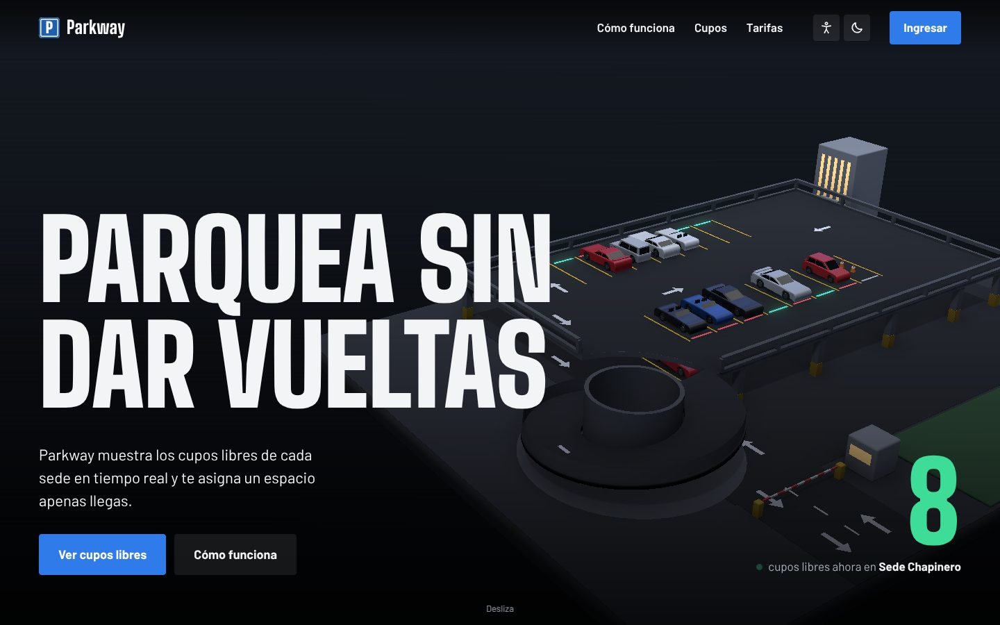

## Interfaz

La interfaz usa modo oscuro y una escena 3D del parqueadero construida con
Three.js. La escena no es decorativa: dibuja cada plaza de la sede con su
estado real en la base de datos y se actualiza cada 5 segundos. Cuando un
operador registra un ingreso, el carro aparece entrando a su plaza; cuando
registra una salida, el carro sale por el carril.

**Portada pública**

- **Primera pantalla.** Vista nocturna de la sede con los cerros orientales y
  la luz de Monserrate al fondo. El contador muestra los cupos libres en ese
  momento.
- **Cómo funciona.** Al hacer scroll, la cámara sigue a un carro: llega a la
  sede, la barrera se abre, el sistema le asigna el primer espacio libre (el
  real, consultado en la base) y se muestra el tiquete con el cobro.
- **Cupos libres ahora.** Cupos por tipo de vehículo en cada sede, sobre la
  vista aérea del parqueadero. Las plazas verdes están libres.
- **Calcula cuánto pagas.** Calculadora con las tarifas vigentes y la misma
  regla de cobro del backend.

**Panel del personal**

- Plano 3D interactivo: se gira con el mouse y, al pasar sobre una plaza,
  muestra su código y la placa. Un clic sobre un vehículo abre el registro de
  su salida.
- Campo de placa con forma de placa amarilla de Bogotá y validación por tipo.
- Tiquete de papel que se "imprime" al registrar un ingreso o una salida.
- Vista "Plano" en 2D para equipos sin aceleración gráfica.

Las fuentes (Big Shoulders Display y Barlow) se incluyen en el proyecto, así
que la interfaz funciona sin conexión a internet. Con `prefers-reduced-motion`
activo se desactivan las animaciones automáticas.

## Estado actual

| Funcionalidad | Requerimiento | Estado |
| --- | --- | --- |
| Inicio de sesión con JWT y control de acceso por rol | RF01 | Implementado |
| Consulta de cupos libres por sede y tipo de vehículo | RF05 | Implementado |
| Registro de ingreso con asignación automática de espacio | RF06 | Implementado |
| Registro de salida con cálculo de permanencia y tarifa | RF07 | Implementado |
| Plano 3D de la sede con el estado real de cada plaza | RF05 | Implementado |
| Salida desde el plano 3D (clic sobre el vehículo) | RF07 | Implementado |
| Mapa de plazas, vehículos activos e historial de salidas | RF05, RF13 | Implementado |
| Bitácora de transacciones (confirmadas y revertidas) | RF14, RNF08 | Implementado en el backend |
| Actualización de disponibilidad sin recargar la página | RF12 | Consulta cada 5 s. WebSocket en la siguiente fase |
| Creación de cuenta de cliente | RF01 | Implementado |
| Vehículos del cliente: registrar, consultar y quitar | RF04 | Implementado |
| Reservas: reservar, cancelar, expiración a los 30 minutos | RF10 | Implementado |
| Estado e historial del cliente (vehículo dentro, valor acumulado, visitas) | RF03 | Implementado |
| Pagos y comprobantes, gestión de tarifas y usuarios por el administrador | RF02, RF08, RF09, RF11 | Siguiente fase |
| Predicción de ocupación con IA | RF15 | Diseño en el documento maestro |

## Operación principal: ingreso y salida de vehículos

**Registrar ingreso (RF06).** El operador escribe la placa y elige el tipo de
vehículo. El sistema valida el formato de la placa, crea el vehículo si no
existe, toma el primer espacio libre del tipo (o el que elija el operador),
abre el registro y marca el espacio como ocupado. Todo ocurre en una sola
transacción: si un paso falla, nada queda a medias.

**Registrar salida (RF07).** El operador elige el vehículo en la lista de
activos. El sistema calcula los minutos con la hora de la base de datos,
aplica la tarifa vigente, cierra el registro y libera el espacio.

Reglas que se cumplen:

- Una placa no puede tener dos ingresos abiertos.
- Un espacio no puede quedar asignado a dos vehículos, ni con operadores
  registrando ingresos al mismo tiempo (`FOR UPDATE SKIP LOCKED` más índices
  únicos parciales en `registro_estacionamiento`).
- La placa debe coincidir con el formato del tipo: automóvil `ABC123`,
  motocicleta `ABC12D`, bicicleta código interno de 3 a 10 caracteres.
- Una placa registrada como motocicleta no puede ingresar como automóvil.
- Cada operación queda en la tabla `transaccion` con el usuario, el
  resultado y el detalle.

## Funciones del cliente

Un cliente crea su cuenta desde "Ingresar" con el enlace "Crea una para
reservar". En su panel tiene cuatro secciones:

- **Mi parqueo.** Reserva un espacio: elige la sede y el vehículo, y el
  sistema aparta el primer espacio libre de ese tipo. La reserva muestra el
  código del espacio, una cuenta regresiva de 30 minutos y el plano 3D con
  su plaza resaltada. Si el vehículo ya está dentro, muestra el espacio, el
  tiempo y el valor acumulado, que se actualiza cada segundo.
- **Mis vehículos.** Agrega placas con la validación por tipo y las quita
  cuando no están dentro ni reservadas. Si la placa ya había entrado como
  visitante, queda asociada a la cuenta.
- **Cupos por sede.** El plano 3D de cada sede, sin placas de otros clientes.
- **Mi historial.** Visitas con su valor y reservas con su estado.

Reglas de la reserva:

- Un vehículo solo puede tener una reserva activa y no puede reservar si
  ya está dentro.
- El espacio queda en estado RESERVADO y no se cuenta como libre.
- Cuando el operador digita la placa, el vehículo entra a su espacio
  reservado y la reserva pasa a CUMPLIDA. Puede entrar aunque no queden
  cupos libres.
- Si el cliente no llega en 30 minutos, la reserva pasa a EXPIRADA y el
  espacio se libera. El backend revisa cada 30 segundos y deja la
  expiración en la bitácora. El plazo se cambia con `RESERVA_MINUTOS` en
  `backend/.env`.

**Cálculo del cobro.** Horas completas por el valor de la hora, más cada
fracción de 15 minutos iniciada por el valor de la fracción. El valor de un
día nunca supera el valor día. Ejemplo para automóvil: 1 h 20 min cuesta
$4.000 + 2 × $1.500 = $7.000.

## Tecnologías

| Elemento | Valor |
| --- | --- |
| Frontend | React 18, TypeScript, Vite |
| 3D | Three.js con React Three Fiber, Drei y postprocesado (bloom) |
| Scroll suave | Lenis |
| Backend | Node.js, TypeScript, Express |
| Base de datos | PostgreSQL |
| Seguridad | JWT, contraseñas con bcrypt |
| Arquitectura | Tres capas (presentación, negocio, datos) con Gestor de transacciones |

## Estructura del repositorio

```
Parkway/
├── database/
│   ├── schema.sql                  # Tablas, claves, restricciones e índices
│   ├── seed.sql                    # Datos de prueba: usuarios, sedes, 65 espacios, tarifas
│   └── demo.sql                    # Opcional: vehículos dentro y salidas del día
├── backend/
│   ├── src/
│   │   ├── app.ts                  # Configuración de Express
│   │   ├── index.ts                # Punto de entrada de la API
│   │   ├── db/pool.ts              # Pool de conexiones a PostgreSQL
│   │   ├── transactions/           # Gestor de transacciones (BEGIN/COMMIT/ROLLBACK + bitácora)
│   │   ├── repositories/           # Acceso a datos (patrón Repository)
│   │   ├── services/               # Reglas de negocio: ingreso, salida, tarifas, sesión
│   │   ├── validators/             # Validación de datos de entrada
│   │   ├── controllers/            # Controladores REST
│   │   ├── routes/                 # Rutas Express
│   │   ├── middlewares/            # JWT, roles y manejo de errores
│   │   └── errors/                 # Errores de negocio con código HTTP
│   ├── tests/                      # Pruebas unitarias (tarifas y validaciones)
│   ├── scripts/pruebaConcurrencia.ts
│   └── .env.example
├── frontend/
│   └── src/
│       ├── pages/                  # Portada, Login, Disponibilidad, Ingreso, Activos, Historial
│       │   └── cliente/            # Mi parqueo, Mis vehículos, Mi historial
│       ├── three/                  # Escena 3D: plazas, vehículos, entorno, cámara
│       ├── components/             # Placa, Tiquete, Odometro, SalidaDialogo, MapaEspacios
│       └── lib/                    # Cliente de la API, formatos, consultas periódicas
├── docs/
│   ├── Proyecto_S8_Parkway.pdf     # Documento maestro
│   └── capturas/                   # Capturas de la interfaz
└── README.md
```

## Requisitos previos

- Node.js 18 o superior
- PostgreSQL 14 o superior
- npm

## Cómo ejecutar el proyecto

### 1. Crear y poblar la base de datos

```bash
createdb parkway
psql -d parkway -f database/schema.sql
psql -d parkway -f database/seed.sql
```

Si PostgreSQL requiere usuario y host explícitos:

```bash
createdb -h localhost -U postgres parkway
psql -h localhost -U postgres -d parkway -f database/schema.sql
psql -h localhost -U postgres -d parkway -f database/seed.sql
```

Para ver el parqueadero con vehículos dentro (recomendado para presentar):

```bash
psql -d parkway -f database/demo.sql
```

`demo.sql` ocupa cerca del 60 % de los espacios y registra salidas del día.
Se puede ejecutar varias veces.

`seed.sql` usa la extensión `pgcrypto` (la crea `schema.sql`) para guardar
las contraseñas con bcrypt.

### 2. Backend

```bash
cd backend
cp .env.example .env      # Ajustar las credenciales de PostgreSQL
npm install
npm run dev               # http://localhost:3000
```

### 3. Frontend

En otra terminal:

```bash
cd frontend
npm install
npm run dev               # http://localhost:5173
```

El frontend envía las peticiones `/api` al backend del puerto 3000. La
portada queda en `http://localhost:5173/#/` y el panel en `#/ingresar`.

### Cuentas de prueba

| Rol | Correo | Contraseña |
| --- | --- | --- |
| Operador | operador1@parkway.test | Operador123* |
| Administrador | admin@parkway.test | Admin123* |
| Cliente | cliente1@parkway.test | Cliente123* |

El operador y el administrador registran ingresos y salidas. El cliente
reserva espacios, registra sus vehículos y consulta su historial;
`cliente1@parkway.test` ya tiene el vehículo ABC123. También se puede crear
un cliente nuevo desde "Crea una para reservar".

## Pruebas

```bash
cd backend
npm test                                   # Pruebas unitarias de tarifas, placas, cuentas y vehículos
npx tsx scripts/pruebaConcurrencia.ts 20   # Con el backend corriendo
```

La prueba de concurrencia envía 20 ingresos simultáneos de bicicleta a la
Sede Zona T, que tiene 3 espacios. Resultado obtenido: 3 aceptados, 17
rechazados con código 409 y ningún espacio duplicado (RNF03).

## API

| Método | Ruta | Acceso | Descripción |
| --- | --- | --- | --- |
| GET | `/api/health` | Público | Estado del servicio |
| POST | `/api/auth/login` | Público | Inicia sesión y devuelve el token |
| POST | `/api/auth/registro` | Público | Crea una cuenta de cliente e inicia la sesión |
| GET | `/api/auth/me` | Sesión | Usuario de la sesión |
| GET | `/api/catalogos/parqueaderos` | Público | Sedes |
| GET | `/api/catalogos/tipos-vehiculo` | Público | Tipos de vehículo con tarifa vigente |
| GET | `/api/estacionamiento/resumen?idParqueadero=1` | Público | Cupos por tipo de vehículo |
| GET | `/api/estacionamiento/disponibilidad?idParqueadero=1&idTipo=1` | Público | Espacios libres |
| GET | `/api/estacionamiento/plano?idParqueadero=1` | Público | Estado de cada espacio, sin placas (escena 3D) |
| GET | `/api/estacionamiento/espacios?idParqueadero=1` | Personal | Mapa de plazas con placa |
| GET | `/api/estacionamiento/activos?idParqueadero=1&placa=ABC` | Personal | Vehículos dentro y valor acumulado |
| GET | `/api/estacionamiento/historial?idParqueadero=1&desde=2026-10-01&hasta=2026-10-31` | Personal | Salidas registradas |
| GET | `/api/estacionamiento/totales-dia?idParqueadero=1` | Personal | Ingresos, salidas y valor del día |
| POST | `/api/estacionamiento/ingreso` | Personal | Registra un ingreso |
| POST | `/api/estacionamiento/salida/:idRegistro` | Personal | Registra una salida |
| GET | `/api/cliente/estado` | Cliente | Reserva activa y vehículos dentro con valor acumulado |
| GET | `/api/cliente/historial` | Cliente | Visitas cerradas |
| GET, POST | `/api/cliente/vehiculos` | Cliente | Consultar y registrar vehículos propios |
| DELETE | `/api/cliente/vehiculos/:placa` | Cliente | Quitar un vehículo de la cuenta |
| GET, POST | `/api/cliente/reservas` | Cliente | Consultar y crear reservas |
| POST | `/api/cliente/reservas/:idReserva/cancelar` | Cliente | Cancelar una reserva activa |

Ejemplo de ingreso:

```bash
curl -X POST http://localhost:3000/api/estacionamiento/ingreso \
  -H "Authorization: Bearer <token>" -H "Content-Type: application/json" \
  -d '{"placa":"ABC123","idTipo":1,"idParqueadero":1}'
```

Errores: 400 si un campo no es válido (con el detalle por campo), 401 sin
sesión, 403 sin permiso, 404 si la sede o el registro no existen y 409 si
una regla de negocio lo impide, por ejemplo cuando no hay espacios libres.

## Capturas

| Cómo funciona: la placa abre la barrera | El sistema asigna el espacio |
| --- | --- |
| 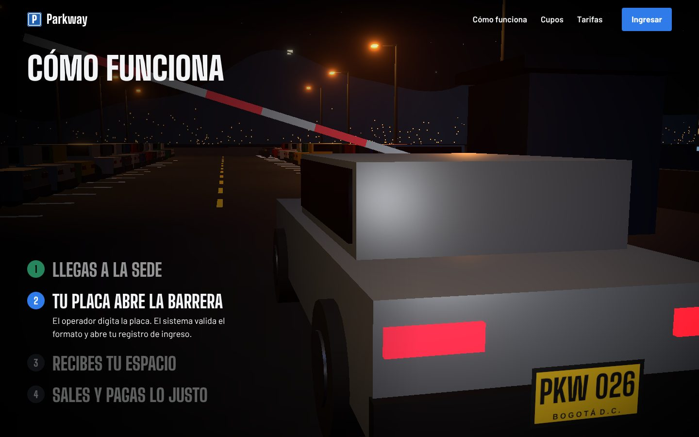 | 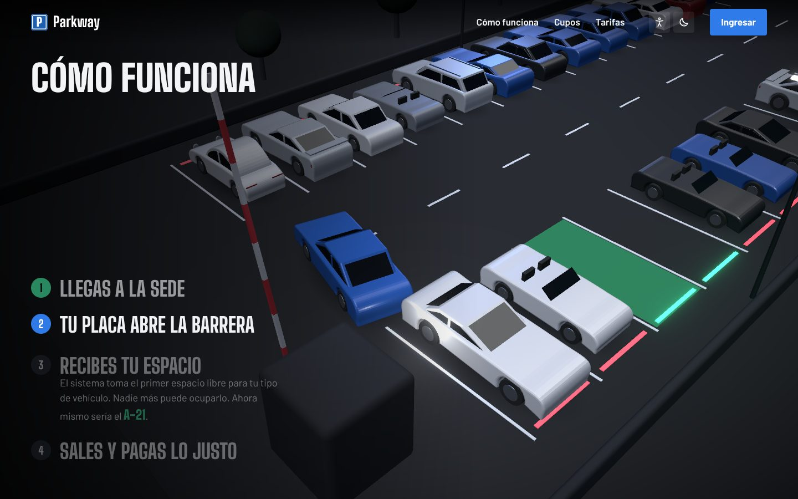 |
| **Cobro al salir** | **Cupos libres ahora** |
| 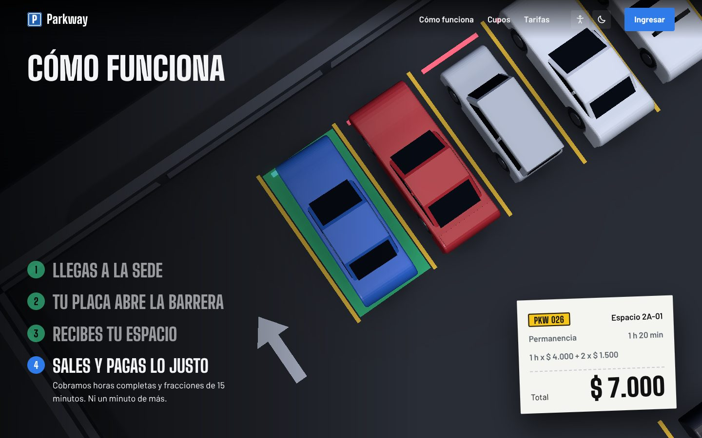 | 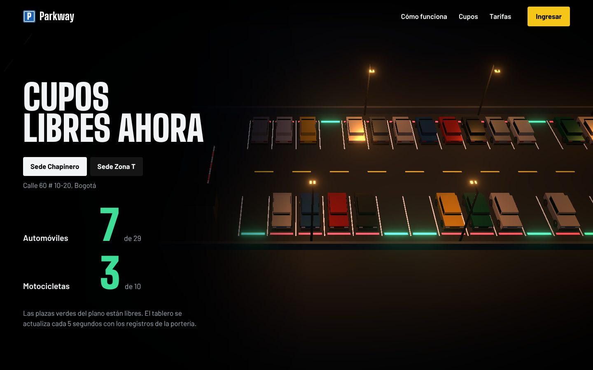 |
| **Calculadora de tarifa** | **Ingreso al panel** |
| 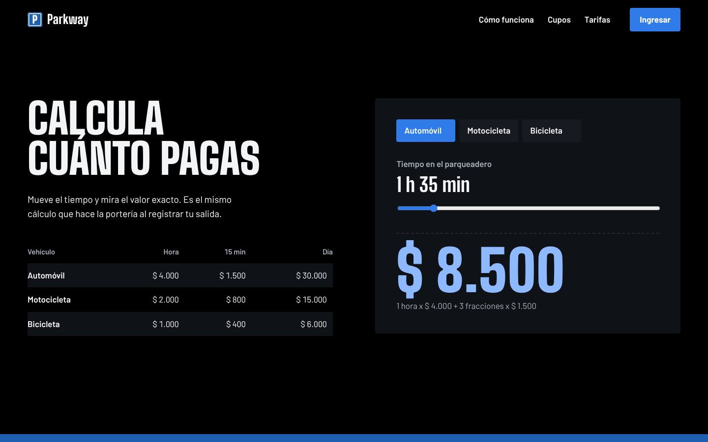 |  |
| **Registrar ingreso** | **Validación de placa** |
| 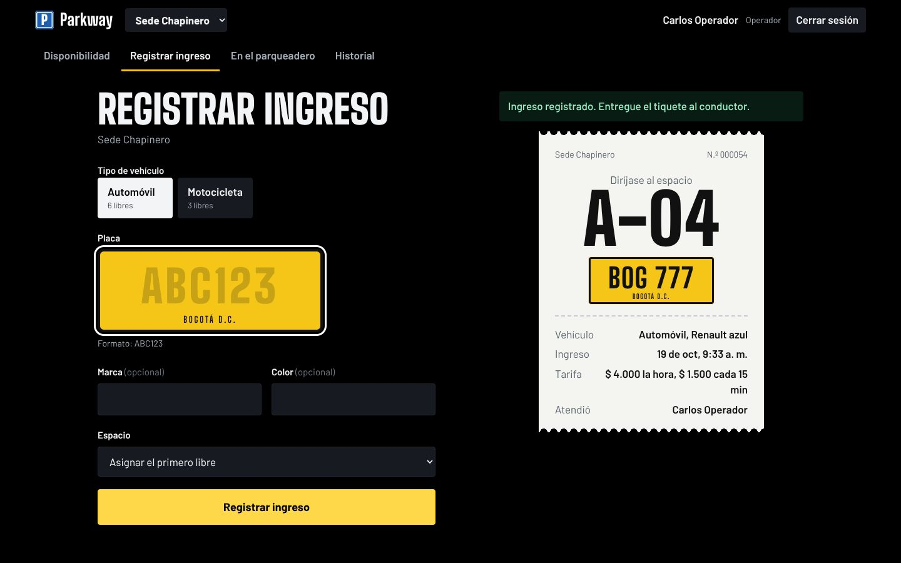 | 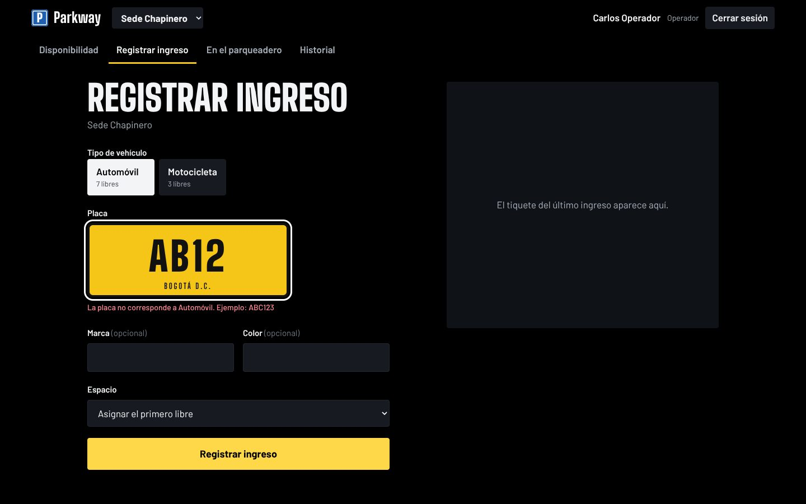 |
| **Plano 3D del panel** | **Vehículos en el parqueadero** |
| 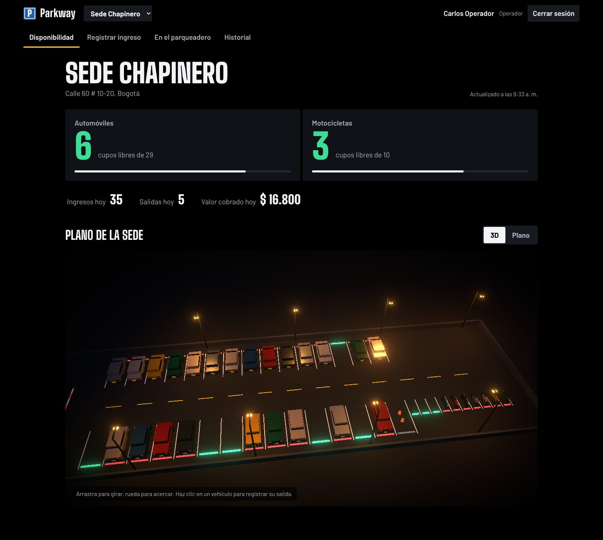 | 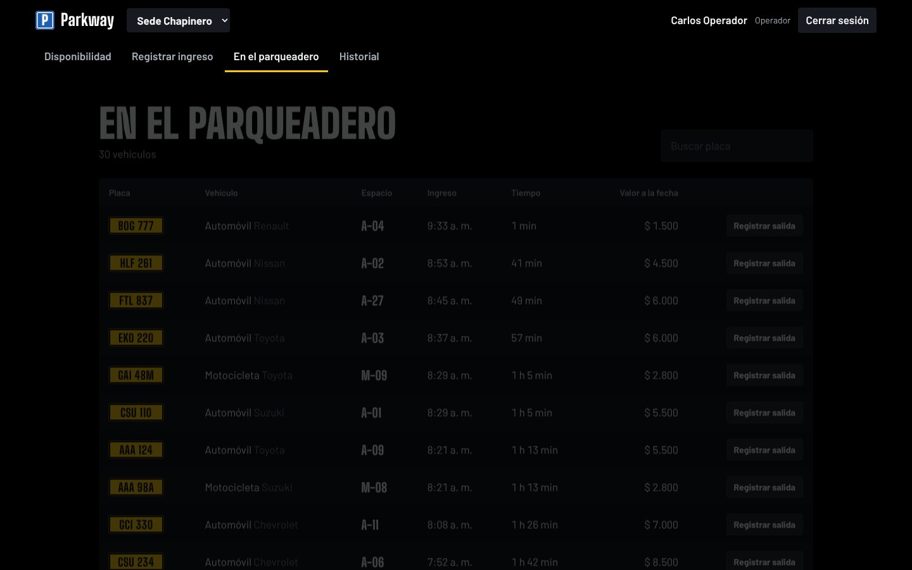 |
| **Salida registrada** | **Historial** |
| 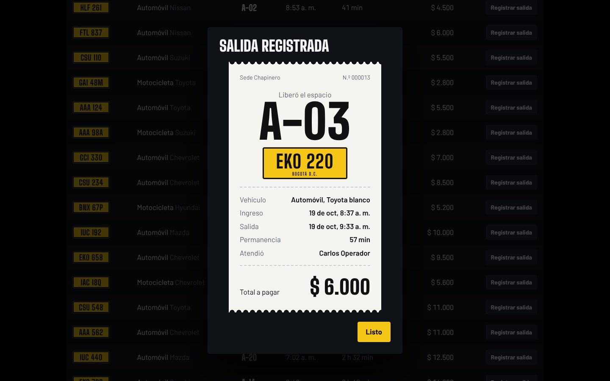 | 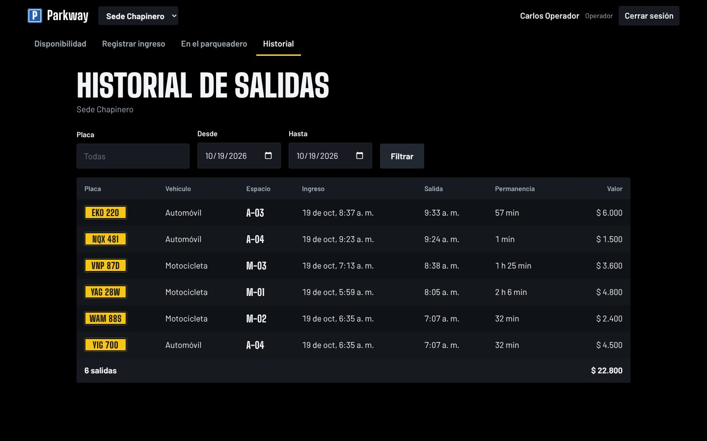 |

| **Reserva del cliente** | **El operador digita la placa reservada** |
| 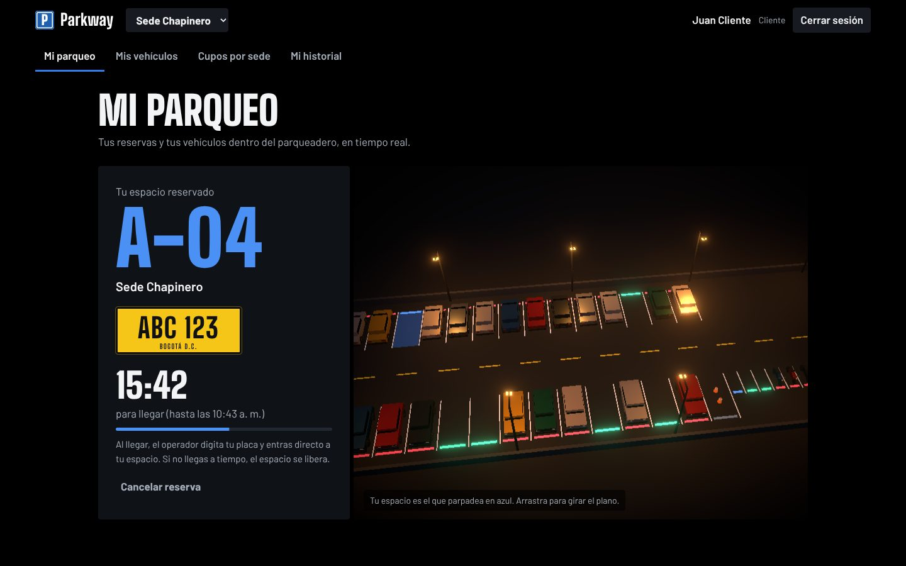 | 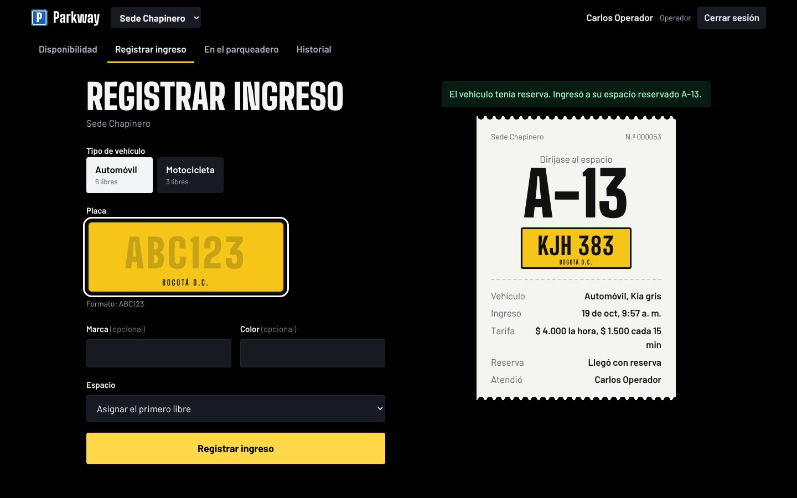 |
| **El cliente ve su vehículo dentro** | **Mis vehículos** |
| 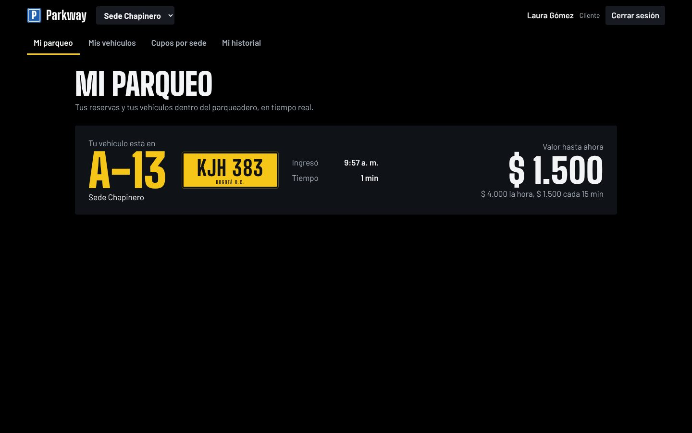 | 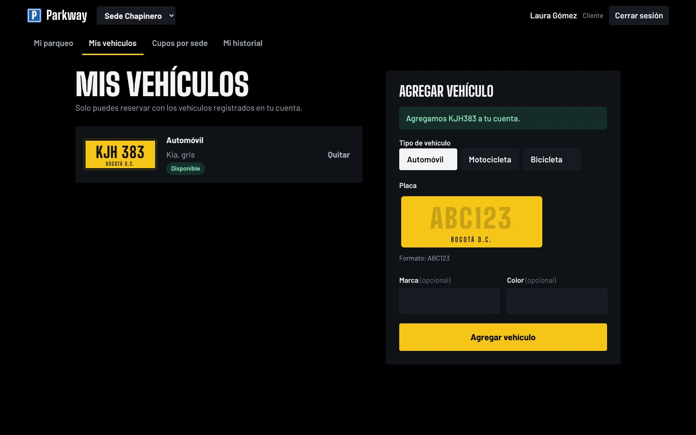 |

**En el celular**

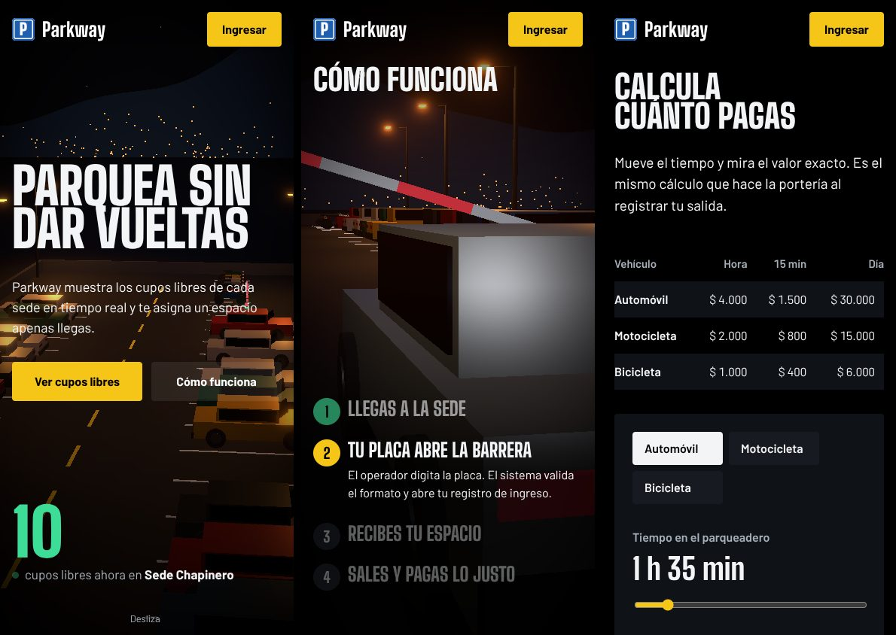
