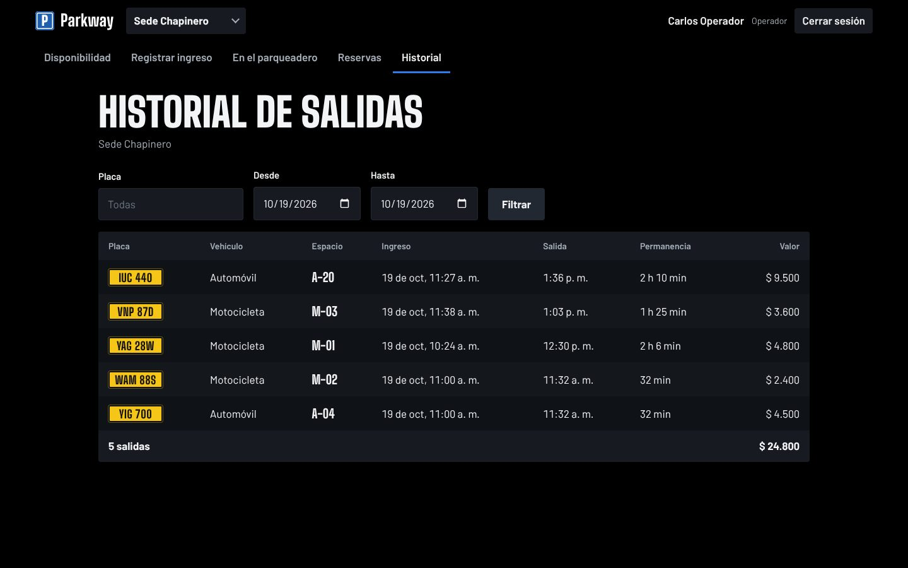

# Frontend de Parkway

Aplicación web en React 18 con TypeScript y Vite. Usa modo oscuro con el azul
de la señal de parqueadero como color de acción; el amarillo se reserva para
las placas. Tiene una escena 3D del parqueadero hecha con Three.js que dibuja
cada plaza con su estado real en la base de datos.

## Contenido

- [Portada pública](#portada-pública)
- [Ingreso y creación de cuenta](#ingreso-y-creación-de-cuenta)
- [Pantallas del cliente](#pantallas-del-cliente)
- [Pantallas del operador](#pantallas-del-operador)
- [Pantalla del administrador](#pantalla-del-administrador)
- [En el celular](#en-el-celular)
- [Cómo está hecha la escena 3D](#cómo-está-hecha-la-escena-3d)
- [Organización del código](#organización-del-código)
- [Diseño y accesibilidad](#diseño-y-accesibilidad)

## Portada pública

La primera pantalla muestra la sede de noche, con los cerros orientales y la
luz de Monserrate al fondo, y un contador con los cupos libres en ese momento.


**Cómo funciona.** Al hacer scroll, la cámara sigue a un carro de prueba
(placa PKW 026) por el flujo real: llega a la sede, la placa abre la barrera,
el sistema le asigna el primer espacio libre que existe en la base de datos en
ese momento y, al final, aparece el tiquete con el cobro.

| La placa abre la barrera | El sistema asigna el espacio | Sales y pagas lo justo |
| --- | --- | --- |
|  |  |  |

**Cupos libres ahora** muestra los cupos por tipo de vehículo en cada sede
sobre la vista aérea del parqueadero. **Calcula cuánto pagas** usa las
tarifas vigentes y la misma regla de cobro del backend. El cierre invita al
personal a entrar al panel y a los clientes a crear su cuenta.

| Cupos libres ahora | Calculadora de tarifa | Cierre |
| --- | --- | --- |
|  |  |  |

## Ingreso y creación de cuenta

El ingreso es el mismo para todos los roles; después de iniciar sesión cada
uno ve solo sus pestañas. El cliente nuevo crea su cuenta con nombre,
documento, correo, teléfono y contraseña; cada campo se valida antes de
enviar y otra vez en el backend.

| Ingreso | Crear cuenta, con validación |
| --- | --- |
|  |  |

## Pantallas del cliente

Pestañas: Mi parqueo, Mis vehículos, Cupos por sede y Mi historial.

- **Mi parqueo.** Si tiene una reserva, muestra el espacio, la cuenta
  regresiva de 30 minutos y el plano 3D con su plaza parpadeando en azul. Si
  su vehículo está dentro, muestra el espacio, el tiempo y el valor
  acumulado, que se actualiza cada segundo. Si no tiene nada activo, muestra
  el formulario para reservar.
- **Mis vehículos.** Agrega placas con la validación por tipo. Marca y color
  se eligen de una lista con la opción "Otro" al final; las marcas cambian
  según sea carro o moto y las bicicletas no llevan marca.
- **Cupos por sede.** El plano 3D de cada sede, sin placas de otros clientes.
- **Mi historial.** Visitas con su valor y reservas con su estado.

| Reserva activa | Mis vehículos | Cupos por sede |
| --- | --- | --- |
|  |  |  |

## Pantallas del operador

Pestañas: Disponibilidad, Registrar ingreso, En el parqueadero, Reservas e
Historial.

**Registrar ingreso.** El campo de placa tiene la forma de una placa de
Bogotá y valida el formato según el tipo de vehículo. Al registrar, el
sistema asigna el espacio y "imprime" el tiquete.

| Validación de placa | Ingreso registrado |
| --- | --- |
|  |  |

**Reservas.** Lista a los clientes que vienen en camino, con su teléfono, el
espacio apartado y el tiempo que les queda. El botón "Registrar ingreso" abre
el formulario con la placa y el tipo ya escritos, y el formulario avisa que
esa placa tiene reserva. Al registrar, el vehículo entra a su espacio
reservado y el tiquete lo indica.

| Reservas de la sede | Aviso de reserva | Ingreso con reserva |
| --- | --- | --- |
|  |  |  |

**Disponibilidad.** Cupos por tipo, movimiento del día y el plano 3D, que se
gira con el mouse. Al pasar sobre una plaza muestra su código y la placa; un
clic sobre un vehículo abre el registro de su salida. La vista "Plano" ofrece
lo mismo en 2D.

| Disponibilidad | Salida desde el plano 3D | Salida registrada |
| --- | --- | --- |
|  |  |  |

**En el parqueadero** lista los vehículos dentro con su tiempo y valor
acumulado, y permite registrar la salida. **Historial** muestra las salidas
con filtros por placa y fechas, y el total cobrado.

| En el parqueadero | Historial |
| --- | --- |
|  |  |

## Pantalla del administrador

Tiene las mismas pestañas del operador más **Bitácora**: todas las
operaciones del sistema con su usuario, resultado y detalle, filtrables por
operación, resultado y fechas. Las operaciones revertidas muestran el motivo
del error.


## En el celular

La interfaz se adapta desde 360 px de ancho. En el teléfono, la cámara de la
portada mira a lo largo del carril y los textos pasan a una sola columna.


## Cómo está hecha la escena 3D

La escena no usa modelos descargados ni imágenes: todo se dibuja con código a
partir de los datos de la base.

**Librerías.** Three.js dibuja en el navegador con WebGL. React Three Fiber
permite escribir la escena como componentes de React. Drei aporta el control
de cámara, las estrellas y las etiquetas sobre las plazas. Postprocessing
agrega el brillo (bloom) de las luces.

**Datos.** La página consulta el estado de cada espacio cada 5 segundos
(`/api/estacionamiento/plano`, o `/espacios` para el personal, que incluye
placas). `three/layout.ts` convierte esa lista en posiciones: un carril con
una fila de plazas a cada lado, con medidas por tipo de vehículo (carro 2,7 ×
5,2 m). Si se agregan espacios en la base, el parqueadero crece solo.

| Archivo | Qué dibuja |
| --- | --- |
| `three/Vehiculo.tsx` | Carros, motos y bicicletas con primitivas; luces delanteras y traseras emisivas |
| `three/Plazas.tsx` | Líneas, testigo de estado (verde libre, rojo ocupado, azul reservado), conos fuera de servicio, animación de entrada y salida |
| `three/Entorno.tsx` | Barrera y caseta, postes de luz de sodio, calle con tráfico, edificios, cerros y Monserrate |
| `three/texturas.ts` | Placas y ventanas de edificios dibujadas en un canvas |
| `three/Escena.tsx` | Cámara, luces, niebla y efectos |
| `three/control.ts` | Estado compartido con la página, sin Three.js |

**Cámara.** Tiene cuatro modos: portada (vuelo lento con paralaje del mouse),
historia (sigue el scroll), vivo (vista aérea) y panel (el usuario la gira y
selecciona plazas).

**Rendimiento.** La escena se descarga en un archivo aparte de unos 900 kB,
así que la página aparece primero. Si el equipo no soporta WebGL se muestra el
plano 2D, y si el sistema tiene activada la opción de reducir movimiento la
cámara no se mueve sola.

## Organización del código

```
frontend/src/
├── App.tsx                 # Rutas, sesión y pestañas por rol
├── pages/
│   ├── Portada.tsx         # Portada pública
│   ├── Login.tsx           # Ingreso y creación de cuenta
│   ├── Disponibilidad.tsx  # Cupos y plano 3D/2D
│   ├── Ingreso.tsx         # Registrar ingreso
│   ├── Activos.tsx         # Vehículos dentro y salida
│   ├── Reservas.tsx        # Reservas de la sede (personal)
│   ├── Historial.tsx       # Salidas registradas
│   ├── Bitacora.tsx        # Bitácora (administrador)
│   └── cliente/            # Mi parqueo, Mis vehículos, Mi historial
├── components/             # Placa, Tiquete, Selector, CampoOpciones, Odometro, diálogos
├── three/                  # Escena 3D
├── lib/
│   ├── api.ts              # Cliente HTTP y tipos de la API
│   ├── useConsulta.ts      # Consultas que se repiten cada N segundos
│   ├── tarifa.ts           # Regla de cobro (igual a la del backend)
│   ├── formato.ts          # Pesos, horas, duraciones y formatos de placa
│   └── ruta.ts             # Rutas por hash (#/, #/ingresar, #/panel)
└── styles.css              # Estilos y variables de color
```

## Diseño y accesibilidad

- **Colores:** fondo negro, azul `#2f7bea` para botones, enlaces y foco, y
  amarillo `#f5c518` solo para placas. En los planos, verde es libre, rojo
  ocupado y azul reservado.
- **Tipografía:** Big Shoulders Display para títulos, inspirada en los rótulos
  de parqueadero, y Barlow para el texto. Las dos se incluyen en el proyecto,
  así que la interfaz funciona sin internet.
- **Listas de selección propias** que siempre se abren hacia abajo y se
  manejan con teclado (flechas, Enter, Escape y letra inicial).
- **Accesibilidad:** foco visible, etiquetas en todos los campos, mensajes de
  error junto al campo, roles ARIA en listas y diálogos, y respeto por la
  opción de reducir movimiento.
- **Validación:** cada formulario valida antes de enviar y muestra los errores
  que devuelve el backend en el campo correspondiente.
